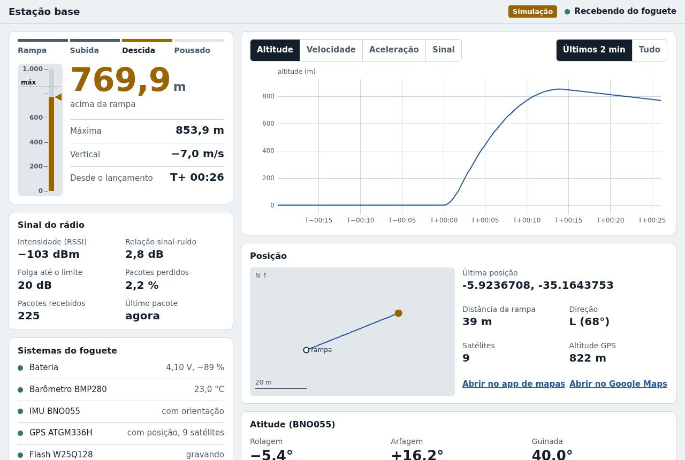

# Telemetria LoRa SX1276 para foguete

Um único projeto PlatformIO com dois firmwares e uma ferramenta para o PC:

- **foguete** (ESP32-C3 SuperMini): lê BMP280, BNO055, GPS ATGM336H e bateria a 50 Hz, estima a fase do voo e transmite telemetria pelo SX1276 a 5 Hz, no quadro que o REYAX RYLR998 aceita (cabeçalho de 5 bytes + pacote em Base64, 93 bytes). Não há armazenamento a bordo: o CanSat cai no oceano e não é recuperado, então tudo que importa vai pelo rádio.
- **base** (ESP32 + **um** receptor LoRa, nada mais): o receptor é o SX1276 (`pio run -e base`) ou o REYAX RYLR998 (`pio run -e base_reyax`), escolhido na compilação. Uma terceira opção é a placa Heltec WiFi LoRa 32 V2, que já traz o SX1276 (`pio run -e base_heltec`). Recebe o quadro do foguete, tira o cabeçalho Reyax, valida (CRC do LoRa + CRC próprio) e conta perdas. Também cria a própria rede Wi-Fi e serve um **dashboard** que abre no navegador de qualquer celular ou notebook, sem internet. Pelo dashboard dá para acompanhar o voo ao vivo e gravar os dados na memória da base quando for pedido. Para ouvir com os dois receptores ao mesmo tempo, use a `base_dupla` do `teste_enlace/`.
- **ferramentas/registrar_serial.py** (opcional): grava no PC a cópia que a base também envia pela USB.
- **teste_enlace/** (projeto separado): teste do enlace com um segundo receptor na base, o REYAX RYLR998. Tem um CanSat simulado que transmite o pacote real com dados fictícios e uma base que recebe pelo SX1276 e pelo RYLR998 ao mesmo tempo. Ver `teste_enlace/README.md` e `docs/arquitetura_enlace_reyax.md`.

## Componentes da missão

| Subsistema | Função | Componente |
|---|---|---|
| OBDH | Microcontrolador | ESP32-C3 SuperMini |
| OBDH | IMU | BNO055 |
| OBDH | Barômetro | BMP280 (módulo 5 V, 4 pinos) |
| OBDH | GPS | ATGM336H-5N-31 |
| OBDH | Armazenamento | nenhum (a W25Q128 tem lugar na PCB, mas não é soldada nem usada) |
| EPS | Bateria | Panasonic NCR18650B |
| EPS | Regulador | 134N3P (HT4928S) ou SX1308 |
| EPS | Carregador | 134N3P (HT4928S) |
| TT&C | Rádio | SX1276 SMD |
| Base | Microcontrolador | ESP32 DevKit + SX1276 ou REYAX RYLR998, ou Heltec WiFi LoRa 32 V2 (SX1276 na placa) |

## Estrutura

```
telemetria-foguete/
├── platformio.ini            ambientes [env:foguete], [env:foguete_voo], [env:foguete_devkit], [env:base], [env:base_reyax] e [env:base_heltec]
├── lib/Telemetria/           CÓDIGO COMPARTILHADO (compilado nos dois)
│   ├── ConfigLoRa.h          frequência, SF, BW, sync word, preâmbulo (compatíveis com o RYLR998)
│   ├── Protocolo.h           pacote de 64 bytes (versão 3), estados, bits de status
│   ├── Protocolo.cpp         CRC16, validação, conversão para CSV
│   └── QuadroReyax.*         quadro do RYLR998: cabeçalho de 5 bytes + Base64 do pacote
├── src/foguete/              ESP32-C3 SuperMini
│   ├── main.cpp              agendador: sensores 50 Hz, TX a cada 200 ms, diagnóstico 1 Hz
│   ├── pinos.h               mapa de pinos (esquemático V1.7 ou DevKit de bancada) e modo do BNO055
│   ├── log.h                 diagnóstico USB (desligável para o voo)
│   ├── radio_tx.*            transmissão LoRa não bloqueante (camada física do RYLR998)
│   ├── sensores.*            BMP280, BNO055, ATGM336H, bateria
│   ├── estado_voo.*          altitude filtrada, velocidade, fase do voo
│   └── comandos.*            comandos pela USB (info, ajuda)
├── src/base/                 ESP32
│   ├── main.cpp              inicia a memória, o Wi-Fi e a tarefa do receptor
│   ├── config_base.h         receptor (SX1276 ou RYLR998), Wi-Fi, histórico, modo simulação
│   ├── pinos.h               DevKit (SX1276 no VSPI, RYLR998 na UART2) ou Heltec WiFi LoRa 32 V2
│   ├── radio_rx.*            receptor SX1276 por interrupção ([env:base] e [env:base_heltec])
│   ├── reyax_rx.*            receptor RYLR998: configuração AT e leitura do +RCV (só no [env:base_reyax])
│   ├── recepcao.*            tarefa do receptor: tira o cabeçalho Reyax, valida, conta perdas, simulação
│   ├── servidor_web.*        rede Wi-Fi própria, dashboard e API
│   ├── gravacao.*            gravação sob demanda na memória interna
│   ├── saida.*               cópia em texto pela USB
│   └── dashboard_html.h      GERADO a partir de web/dashboard.html
├── web/
│   └── dashboard.html        o dashboard (HTML, CSS e JavaScript num arquivo só)
├── ferramentas/
│   ├── gerar_dashboard.py    embute o dashboard no firmware (roda sozinho)
│   └── registrar_serial.py   grava a cópia USB da base no PC (opcional)
├── docs/
│   └── arquitetura_enlace_reyax.md   enlace SX1276 -> SX1276 + RYLR998 (pesquisa e projeto)
└── teste_enlace/             PROJETO SEPARADO: teste do enlace com o RYLR998
```

Tudo que precisa ser igual nos dois lados (rádio e formato do pacote) fica em `lib/Telemetria`.

## Ligações do foguete (ESP32-C3 SuperMini)

Os pinos seguem o esquemático da PCB V1.7 (`hardware/backup_projetos/Projeto_V1_7.epro2`). O SX1276 usa o SPI e o BMP280 e o BNO055 dividem o I2C.

| Função | Componente / pino | Net no esquemático | GPIO da C3 |
|---|---|---|---|
| SPI SCK | SX1276 SCK | SCK | 4 |
| SPI MISO | SX1276 SO | MISO | 5 |
| SPI MOSI | SX1276 SI | MOSI | 6 |
| CS do rádio | SX1276 NSS | CS2 | 3 |
| Reset do rádio | SX1276 RST | RESET | 2 |
| Interrupção do rádio | SX1276 DIO0 | INTER | 0 |
| I2C SDA | BMP280 SDA + BNO055 SDA | SDA | 8 |
| I2C SCL | BMP280 SCL + BNO055 SCL | SCL | 9 |
| GPS TX → ESP RX | ATGM336H TX | ESP_RX | 10 |
| GPS RX ← ESP TX | ATGM336H RX | ESP_TX | 20 |
| Tensão da bateria | divisor 100k/100k a partir do B+ | V_Bat | 1 |
| (livre) | CS da W25Q128, que não é soldada | CS1 | 7 |

Detalhes que costumam dar problema:

- **W25Q128:** não é usada e não deve ser soldada. O firmware não mexe no GPIO7. Se um dia ela for soldada sem ser usada, o /CS dela precisa ficar em nível alto, senão ela responde no MISO junto com o rádio.
- **GPIO2 (reset do rádio):** é pino de *strapping* da C3, mas pelo datasheet (v2.4, Tabela 3-3, nota 2) ele não define o modo de boot. A Espressif só recomenda um pull-up contra ruído, então ligá-lo ao RESET do SX1276 não impede a placa de ligar.
- **BMP280 de 5 V (4 pinos):** alimente o VIN com **3,3 V**. Esse módulo tem regulador próprio e funciona assim, e isso garante que os resistores de pull-up do I2C fiquem em 3,3 V. Se ele for ligado em 5 V, meça SDA e SCL em repouso: acima de 3,6 V pode danificar a ESP32-C3.
- **BNO055:** pelo mesmo motivo, alimente com 3,3 V. O firmware procura o sensor em 0x28 e 0x29 (as placas GY-BNO055 costumam vir em 0x29).
- **ATGM336H:** alimente com 3,3 V. Ele sai de fábrica em NMEA a 9600 baud, 1 Hz, que é o que o firmware espera.
- **SX1276 SMD:** 3,3 V apenas, com um capacitor de 100 µF perto do módulo. A antena vai soldada no pad ou no conector U.FL.

### Bancada com ESP32 DevKit V1

Para testar o firmware do foguete sem a placa de voo, grave o ambiente `foguete_devkit` numa ESP32 DevKit V1. É o mesmo código, com `PLACA_DEVKIT=1`, que troca o mapa de pinos, e sem as flags da USB nativa da C3: o diagnóstico sai pelo conversor USB-serial da DevKit. Os pinos da C3 não servem na ESP32 clássica, porque os GPIO6 a 11 são da flash interna e travam a placa.

| Função | Componente / pino | GPIO da DevKit |
|---|---|---|
| SPI SCK / MISO / MOSI | SX1276 SCK / SO / SI | 18 / 19 / 23 |
| CS / reset / interrupção do rádio | SX1276 NSS / RST / DIO0 | 5 / 14 / 26 |
| I2C SDA / SCL | BMP280 + BNO055 | 21 / 22 |
| GPS TX → ESP RX / GPS RX ← ESP TX | ATGM336H | 16 / 17 |
| Tensão da bateria (opcional) | divisor 100k/100k | 34 |

O SX1276 fica nos mesmos pinos da estação base. Nunca grave o `foguete_devkit` na C3 SuperMini, nem o `foguete`/`foguete_voo` na DevKit.

## Alimentação (EPS)

```
NCR18650B ─► 134N3P / HT4928S (carga + boost) ─► 5 V ─► pino 5V da SuperMini
     │                                                    └─► regulador 3,3 V da placa
     └─► divisor 100k/100k ─► GPIO1                          ─► SX1276, BNO055, BMP280,
                                                                ATGM336H
```

O consumo de pico em 3,3 V fica em torno de 200 mA (rádio transmitindo a 17 dBm + GPS + sensores). Confira se o regulador da sua SuperMini aguenta isso com folga. Com a NCR18650B (3.400 mAh), a autonomia esperada é da ordem de 10 horas ou mais.

- **SX1308:** a saída desses módulos é ajustável por trimpot. Ajuste para 5,0 V com um multímetro **antes** de ligar a placa.
- **Módulos de power bank (134N3P):** alguns desligam sozinhos quando a corrente de carga é baixa. Teste o foguete ligado por pelo menos uma hora no consumo real antes da missão.
- Evite ligar o USB do computador e o boost no pino 5V ao mesmo tempo, a não ser que confirme que a sua placa tem diodo de proteção.

## BNO055: escolha do modo

O BNO055 tem uma limitação importante para foguetes: **nos modos de fusão (que calculam a orientação), o próprio chip trava o acelerômetro em ±4 g**. Durante a queima do motor a aceleração costuma passar disso. O modo é escolhido no `platformio.ini`:

| `IMU_MODO_ALTO_G` | Orientação (quaternion) | Acelerômetro |
|---|---|---|
| 0 (padrão) | sim, fusão NDOF | satura em ±4 g |
| 1 | não | até ±16 g |

A detecção de lançamento funciona nos dois modos (ela usa 2,5 g). O campo magnético medido pelo BNO055 (X, Y e Z em µT, nos dois modos) e a calibração (0 a 3 para sistema, giroscópio, acelerômetro e magnetômetro) vão na telemetria. No modo NDOF, o magnetômetro só calibra com movimento, e motor ou partes metálicas por perto atrapalham a bússola.

A orientação mostrada na base (rolagem, arfagem e guinada) depende de como o sensor está montado. Se o eixo longo do foguete for o eixo X ou Y do BNO055, a arfagem fica perto de ±90° com o foguete na vertical, onde os ângulos de Euler perdem precisão. Para análise, use o quaternion do CSV.

## Testes de bancada (diagnóstico pela USB)

O firmware do foguete funciona com qualquer combinação de componentes soldados. Nenhuma falha trava a execução:

- **BMP280, BNO055:** são procurados no I2C ao ligar. O que não responder fica de fora, com o bit de status em 0, e o resto segue. Depois de soldar um componente, aperte RESET para ele ser procurado de novo.
- **GPS:** sem GPS, a UART só não recebe nada.
- **SX1276:** se não responder, o foguete segue lendo os sensores e tenta iniciar o rádio de novo a cada 5 s.
- **Bateria:** o ADC sempre devolve um valor. Confira com um multímetro.

Com `pio device monitor -e foguete`, o ambiente de testes (`[env:foguete]`) mostra ao ligar o resultado da procura de cada componente e, depois, um bloco por segundo com uma linha para cada um:

```
---- t=12.0 s | RAMPA | alt 0.0 m (max 0.0) | v +0.0 m/s | pacote seq 55 ----
[BMP280] ok    | 94512 Pa | 24.87 C
[BNO055] ok    | acel +0.01 -0.02 +1.00 g | giro +0.1 +0.0 -0.1 graus/s | mag +23.1 -8.7 -4.6 uT | quat +1.000 ... | cal S0 G3 A0 M0
[GPS]    ok    | 48 frases validas, 0 com erro | 0 satelites | sem posicao ainda (...)
[BAT]    3.95 V (pino GPIO1: 1975 mV)
[LoRa]   ok    | 55 enviados | 0 pulados (ocupado) | 0 erros | 0 timeouts
```

Quando algo falha, a linha diz o quê, por exemplo `[BNO055] FALHA: nao encontrado na inicializacao`, `[GPS] FALHA: nenhum byte recebido (TX do GPS -> GPIO10?)`, `[GPS] AVISO: chegam bytes, mas nenhuma frase NMEA valida` (baud errado) ou `[LoRa] ok ... | DIO0 (GPIO0) nao chega?` (o rádio responde, mas a interrupção de fim de transmissão não chega).

Comandos pela USB (monitor serial a 115200, só funcionam no solo):

```
info    estado do voo, dos sensores e do rádio
ajuda   lista os comandos
```

**Para o lançamento**, grave o ambiente `[env:foguete_voo]`. É o mesmo firmware com `DIAGNOSTICO_USB=0`: as mensagens de diagnóstico nem são compiladas. Os comandos continuam disponíveis.

## Compilar e gravar

Com o VS Code + extensão PlatformIO, abra a pasta do projeto e use:

```
pio run -e foguete -t upload       grava o foguete para testes (com diagnóstico)
pio run -e foguete_voo -t upload   grava o foguete para o lançamento
pio run -e foguete_devkit -t upload grava o foguete numa ESP32 DevKit V1 (só bancada)
pio device monitor -e foguete      vê o diagnóstico do foguete
pio run -e base -t upload          grava a base com o SX1276
pio run -e base_reyax -t upload    grava a base com o RYLR998
pio run -e base_heltec -t upload   grava a base numa Heltec WiFi LoRa 32 V2
pio device monitor -e base         vê a telemetria chegando
```

Na primeira gravação da C3 SuperMini, se ela não for reconhecida: segure o botão BOOT, conecte o USB (ou aperte RESET) e solte o BOOT.


## Estação base e dashboard



A base funciona só com a ESP32 e um receptor LoRa. Ela cria uma rede Wi-Fi própria; não precisa de internet, roteador nem programa instalado.

O receptor é escolhido pelo ambiente de compilação (`RECEPTOR_BASE` em `src/base/config_base.h`). Todos recebem o mesmo quadro do foguete e entregam o mesmo pacote: dashboard, gravação e cópia USB são iguais em todos. Na DevKit, a fiação é a mesma da `base_dupla`:

| Ambiente | Receptor | Ligações (módulo → ESP32) |
|---|---|---|
| `base` | SX1276 (SPI) | SCK → GPIO18, MISO → GPIO19, MOSI → GPIO23, NSS → GPIO5, RST → GPIO14, DIO0 → GPIO26. O firmware tira o cabeçalho Reyax de 5 bytes. |
| `base_reyax` | REYAX RYLR998 (UART2, 115200) | TXD (pino 4) → GPIO16, RXD (pino 3) ← GPIO17, NRST desligado, 3,3 V. A base configura o módulo por AT a cada boot (`AT+BAND`, `AT+PARAMETER`, `AT+NETWORKID`, `AT+ADDRESS`) e confere que não há `AT+CPIN`. |
| `base_heltec` | SX1276 da Heltec WiFi LoRa 32 V2 | Nenhuma: o rádio já vem soldado na placa. Só a antena no conector IPEX. |

No RYLR998 o próprio módulo descarta quadros com CRC errado, então o contador de erros de CRC fica em zero; a linha de espera na USB mostra os `+RCV` recebidos, as linhas mal formadas e os `+ERR` do módulo.

### Base com a Heltec WiFi LoRa 32 V2

A Heltec WiFi LoRa 32 V2 (placa branca com tela OLED, micro-USB e "V2" impresso perto do conector de antena) junta numa placa só uma ESP32 clássica de dois núcleos, um SX1276, 8 MB de flash, o conversor USB-serial CP2102 e um carregador de bateria LiPo. O ambiente `base_heltec` grava nela o mesmo firmware da `base`: só mudam o `board` e os pinos (escolhidos sozinhos em `src/base/pinos.h`). Dashboard, gravação e cópia USB são iguais. A linha de abertura na USB mostra `receptor SX1276 (Heltec WiFi LoRa 32 V2)`.

**Antes de comprar ou gravar, confira a frequência.** A Heltec vende a mesma placa em duas versões: 868/915 MHz, com SX1276, e 433/470 MHz, com SX1278. O enlace usa 915,2 MHz; a versão de 433 MHz não serve, e o firmware não tem como perceber a diferença (os dois chips respondem igual). A frequência vem na etiqueta do saquinho ou no anúncio. A antena que acompanha a placa também é da faixa comprada.

Pinos, conferidos no esquemático da Heltec (V2.1, versão 868-915):

| Função | GPIO | Usado pela base? |
|---|---|---|
| SX1276 SCK / MISO / MOSI | 5 / 19 / 27 | sim |
| SX1276 NSS / RST / DIO0 | 18 / 14 / 26 | sim |
| SX1276 DIO1 / DIO2 | 35 / 34 | não (a recepção só precisa do DIO0) |
| LED branco "LED" (ativo em alto) | 25 | sim, pisca a cada pacote |
| OLED SSD1306 128x64: SDA / SCL / RST | 4 / 15 / 16 | não, a tela fica apagada |
| Vext (liga a tela e os pinos "Vext"; ativo em BAIXO) | 21 | não |
| Bateria, divisor 220k/100k (só na V2.1, ligado pelo GPIO21) | 37 | não |
| Cristal de 32,768 kHz | 32 e 33 | (ocupados) |
| Botão PRG | 0 | não |

Cuidados com a Heltec:

- **Não ligue nada nos GPIO 5, 14, 18, 19, 26 e 27**: são do rádio, embora apareçam nos pinos laterais.
- **Antena antes de ligar.** A base só recebe, então sem antena ela não queima, mas não ouve nada. Use uma antena de 915 MHz no conector IPEX.
- **Bateria:** o conector é Molex PicoBlade de 1,25 mm. Confira a polaridade do cabo antes de ligar: invertida, ela queima a placa. O carregador (TP4054) carrega a LiPo de 3,7 V devagar, cerca de 100 mA, enquanto a USB está ligada.
- **Flash:** o ambiente declara 4 MB, embora a placa original tenha 8 MB. A tabela de partições `no_ota.csv` só ocupa 4 MB, e assim o mesmo firmware roda também nos clones com flash de 4 MB, que travariam no boot com 8 MB no cabeçalho.
- **Driver:** se o Windows não criar a porta COM, instale o driver CP210x da Silicon Labs. A gravação é automática; se falhar, segure o botão PRG enquanto ela começa.
- O GPIO21 também é o SDA padrão da ESP32, mas nessa placa ele comanda o Vext. Não use o I2C padrão (21/22) sem lembrar disso.

1. Ligue a base (pela USB ou por uma power bank).
2. No celular ou notebook, conecte na rede **EstacaoBase-Foguete** (senha `foguete123`; troque em `src/base/config_base.h` antes da missão).
3. Abra **http://192.168.4.1** no navegador.

Se o Android avisar que a rede "não tem internet", escolha manter a conexão. Até 4 aparelhos podem acompanhar ao mesmo tempo.

O dashboard mostra:

- a fase do voo (rampa, subida, descida, pousado) e a altitude num altímetro com a marca da máxima;
- a velocidade vertical e o tempo desde o lançamento;
- a qualidade do sinal: intensidade (RSSI), relação sinal-ruído, folga até o limite do receptor e pacotes perdidos;
- gráficos de altitude, velocidade, aceleração e sinal (últimos 2 minutos ou o voo todo);
- a posição GPS, com a trajetória vista de cima, a distância da rampa e links para abrir no app de mapas;
- a atitude do BNO055 e o nível de calibração;
- o estado de cada sistema do foguete e alertas em destaque: sem sinal (com a última posição), bateria baixa, sensor com falha.

Quem abre o dashboard no meio do voo recebe os últimos 2 minutos que a base guarda na memória.

**Salvar os dados**, de duas formas:

- **Gravação na estação base:** os botões "Iniciar gravação" e "Parar gravação" guardam os pacotes na memória interna da ESP32 (cerca de 75 minutos a 5 Hz). A gravação continua mesmo se o celular desconectar ou a tela apagar. Depois de parar, "Baixar CSV" entrega o arquivo com a hora UTC de cada pacote (a base acerta o relógio pelo celular) e "Apagar gravação" libera o espaço.
- **Baixar dados desta tela:** salva no aparelho tudo o que a página recebeu desde que foi aberta. Serve de reserva se ninguém lembrou de iniciar a gravação.

Por dentro, a base roda duas tarefas em paralelo:

- uma, de prioridade alta, só lê o rádio, para nenhum pacote se perder durante um download;
- outra cuida do Wi-Fi, do dashboard e da gravação.

O dashboard pede os dados novos 4 vezes por segundo pela rota `/api/dados`. A base continua enviando uma cópia em texto pela USB, então o `registrar_serial.py` ainda funciona como reserva.

**Testar sem foguete:** com `-DSIMULAR_FOGUETE=1` no `[env:base]` do `platformio.ini`, a base gera um voo fictício (até ~850 m, com paraquedas e vento). Dá para testar o dashboard só com a ESP32, sem nem o módulo LoRa.

**Mudar o visual:** edite `web/dashboard.html` e compile a base de novo. O `gerar_dashboard.py` comprime a página e a coloca no firmware automaticamente.

## Rádio: alcance x taxa

Os parâmetros ficam em `lib/Telemetria/ConfigLoRa.h`: 915,2 MHz, SF7, 125 kHz, CR 4/5, sync word 0x12 (`AT+NETWORKID=18`), preâmbulo 12, header explícito, CRC ligado, IQ normal. São os valores que o RYLR998 aceita, iguais aos do `teste_enlace/lib/Enlace/ConfigEnlace.h`. Se mudar algum, mude também lá e na configuração AT do RYLR998.

O que vai no ar é o quadro do `QuadroReyax.h`:

```
[00 00] [C5 00] [58] [ 88 caracteres Base64 do PacoteTelemetria ]   = 93 bytes
  dst     src    len
 (todos) (197)  (88)
```

Cada passo de SF dá cerca de 2,5 dB a mais de sensibilidade (mais alcance), mas quase dobra o tempo no ar. Valores para o quadro de 93 bytes com BW 125 kHz, CR 4/5 e preâmbulo 12 (a 125 kHz o RYLR998 só aceita SF7 a SF9):

| SF | Tempo no ar | `TLM_PERIODO_MS` sugerido | Taxa |
|---|---|---|---|
| 7 | 168 ms | 200 | 5 Hz |
| 8 | 295 ms | 400 | 2,5 Hz |
| 9 | 529 ms | 700 | ~1,4 Hz |

O foguete imprime o tempo no ar real ao ligar (e no comando `info`) e avisa se o período estiver curto demais. Depois do teste T3 do documento, `-DTLM_CODIFICACAO=0` nos `build_flags` do foguete manda o pacote em binário: quadro de 69 bytes, ~132 ms em SF7.

Verifique a faixa do seu módulo SX1276 SMD: o firmware vem em 915 MHz (faixa usual no Brasil). Se o módulo for de 433 MHz, mude `LORA_FREQ_HZ` (e o `AT+BAND` do RYLR998).

## Cópia da base pela USB

Além do dashboard, a base envia tudo pela USB. Linhas `TLM,...` são dados (uma por pacote). Linhas `#` são para leitura humana: um resumo por segundo, orientação e calibração do BNO055, e alertas (sensor com falha, bateria abaixo de 3,5 V, perda de sinal com a última posição GPS). Para gravar essa cópia no PC: `python ferramentas/registrar_serial.py COM5`.

```
# [SUBIDA] alt 523.4 m (max 523.4) v +85.2 m/s | GPS fix 8 sats -23.5505123,-46.6333456 | bat 3.92 V | RSSI -87 dBm SNR 9.2 dB | perda 1.0%
#    orientacao rol +2.1 arf -1.4 gui 87.5 graus | calibracao BNO055 S3 G3 A2 M1 (0..3)
```

## Antes de voar

1. Com o ambiente `foguete` gravado, confira no monitor serial que BMP280, BNO055, GPS, bateria e LoRa aparecem como `ok` no bloco de diagnóstico.
2. Confira no dashboard que nenhum sistema aparece com falha.
3. Teste de bancada com os dois lados ligados: no dashboard, a perda deve ficar perto de 0%.
4. Faça uma gravação de teste na base, baixe o CSV e apague, para conferir o fluxo antes do dia.
5. Teste de alcance no solo com o foguete montado e a antena na posição de voo. O dashboard mostra a "folga até o limite" do receptor; procure ter uns 20 dB na distância esperada.
6. Levante o foguete 1 a 2 m e veja a altitude responder na base.
7. Deixe o foguete ligado pelo tempo de espera previsto na rampa, para testar a bateria e o módulo de alimentação.
8. Ajuste os limiares de `estado_voo.cpp` para o seu motor.
9. Grave o foguete com `pio run -e foguete_voo -t upload` para o voo.

## Cuidados

- **Nunca transmita sem antena conectada**: isso pode queimar o amplificador do SX1276.
- Fuselagem de fibra de carbono ou alumínio bloqueia o sinal de rádio e de GPS. Fibra de vidro, papelão e PLA deixam passar.
- Antena de 1/4 de onda em 915 MHz: cerca de 8,2 cm. Na base, uma antena direcional (Yagi) aumenta muito o alcance.
- Se a ESP32-C3 reiniciar no ar, ela recalibra o "zero" de altitude onde estiver. Como não há gravação a bordo, o que a base não recebeu se perde: capriche na alimentação e na fixação dos conectores.
- A detecção de fase do voo é apenas **informativa**. Não use este código para acionar paraquedas: use um altímetro de recuperação dedicado e testado.
