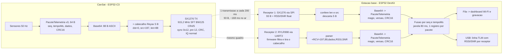

# Enlace de telemetria CanSat → base: SX1276 + RYLR998 recebendo o mesmo quadro

**Arquitetura, formato de quadro e plano de validação em bancada**
Versão 2 · 09/11/2026 · Projeto `Documentos/telemetria` (PlatformIO, Arduino, RadioLib)
Mudanças da versão 2: pacote de telemetria v3 (64 bytes, com o magnetômetro do BNO055); código de referência executável no projeto `teste_enlace/` (Código 1 = CanSat simulado, Código 2 = base com SX1276 + RYLR998).

---

## Resumo

- **O problema confirmado.** O RYLR998 não aceita LoRa "cru". O firmware dele põe 5 bytes antes do payload, `[dst_lo, dst_hi, src_lo, src_hi, len]`, e descarta em silêncio qualquer pacote sem esse cabeçalho. Isso foi medido em hardware por um projeto de terceiros (wayfinder, out/2026). **⚠️ A VALIDAR** com o seu módulo: o guia oficial fala em "+8 bytes" de overhead, o que contradiz a captura (§A.2).
- **A decisão.** O SX1276 do CanSat transmite **uma única vez** por ciclo um quadro de 93 bytes: `cabeçalho Reyax (5 B) + telemetria em Base64 (88 B)`. Parâmetros: 915,2 MHz, SF7, 125 kHz, CR 4/5, preâmbulo 12, sync word 0x12 (= `AT+NETWORKID=18`), header explícito, CRC ligado, IQ normal. O quadro fica ~168 ms no ar e cabe no período atual de 200 ms.
- **Na base.** O RYLR998 entrega `+RCV=197,88,<base64>,<RSSI>,<SNR>`. O SX1276 recebe os 93 bytes e descarta os 5 primeiros. Os dois caminhos decodificam o mesmo Base64 e validam o CRC16 da aplicação. A base junta as duas cópias pela chave (seq, tempoMs) e emite cada pacote uma vez, com RSSI/SNR de cada receptor.
- **O que muda no firmware atual:** sync word 0x2B → 0x12, preâmbulo 8 → 12, frequência 915,0 → 915,2 MHz (motivo regulatório), cabeçalho de 5 bytes, payload em Base64, buffer de RX da base de 64 → 245 bytes. Independente disso, o `PacoteTelemetria` passou para a versão 3 (64 bytes) com o campo do magnetômetro, que faltava.
- **Estado do código (§11).** O projeto `teste_enlace/` compila nos ambientes `cansat_sim`, `cansat_sim_devkit`, `base_dupla` e `bancada` (RadioLib 7.8.1). A montagem do quadro, o Base64, o parser `+RCV` e a fusão foram testados no PC, ponta a ponta e contra os bytes capturados pelo wayfinder; o dashboard foi testado no navegador com uma API simulada. **Nada foi testado em rádio real.** O procedimento de bancada da §8 existe para isso.

### Legenda de confiança

| Marca | Significado |
|---|---|
| **[DOC]** | Documentado oficialmente (Reyax ou Semtech) |
| **[RE-HW]** | Verificado por engenharia reversa com hardware real (bytes capturados, teste automatizado) |
| **[RE-SDR]** | Engenharia reversa com SDR. Fonte única, hoje fora do ar, lida só por trechos indexados |
| **[INF]** | Inferido a partir das fontes acima. Raciocínio, não medição |
| **[?]** | Sem informação confiável. Vira teste de bancada |

---

## Parte A — Pesquisa: formato over-the-air do RYLR998

### A.1 Fontes encontradas e peso de cada uma

1. **Guia AT oficial RYLR998/RYLR498** (Reyax, rev. 20/05/2021) e **datasheet do RYLR998** (10/07/2021). São a fonte primária para comandos e limites, mas não descrevem o formato no ar.
2. **wayfinder (benj2468), PR #91.** Biblioteca Rust `libs/rylr998/src/air.rs` mais um teste HIL entre uma NUCLEO-WL55JC1 (STM32WL, rádio SX126x integrado) e um RYLR998 a 915 MHz. O autor capturou com o WL55 pacotes enviados pelo RYLR998 (as fixtures do teste são esses bytes, de 03/10/2026). Depois transmitiu quadros para o RYLR998 e provou que (a) os quadros com cabeçalho chegam e (b) os sem cabeçalho são descartados. O teste foi validado por mutação: uma imagem que enquadrava a resposta "sem cabeçalho" fez o teste falhar. **É a fonte mais forte encontrada.** Limites: um projeto, um módulo, versão de firmware do RYLR998 não registrada, só NETWORKID=18, só SF7/125 kHz/CR 4/8/preâmbulo 8.
3. **gr-rylr998** (Ryan Malloy, `git.supported.systems`, fev/2026). Blocos GNU Radio de TX/RX para o RYLR998. O repositório migrou e hoje mostra "Migration failed". Só li trechos indexados pelo buscador, então uso apenas a afirmação sobre NETWORKID ↔ sync word, com confiança baixa.
4. **RYLR896.** Não encontrei engenharia reversa do formato no ar. Só dados gerais: usa SX1276, NETWORKID 0–16 (padrão 0). Não serve de base.
5. **Fóruns** (Arduino, TTN, B4X, Hackster). Nada com captura real do formato. Só confirmam o fluxo AT (esperar `+OK` antes do próximo comando) e que o `<Data>` é tratado como texto.

### A.2 Estrutura do payload LoRa gerado pelo Reyax

| Afirmação | Fonte | Confiança |
|---|---|---|
| `AT+SEND=<dst>,<n>,<dados>` vai ao ar como `[dst_lo, dst_hi, src_lo, src_hi, n][dados]` | wayfinder `air.rs` (fixtures capturadas) | **[RE-HW]** |
| Endereços são `uint16` little-endian; `src` = `AT+ADDRESS` de quem transmite | idem (0x0102 → `02 01`) | **[RE-HW]** |
| `len` (byte 4) = tamanho **só do payload**, sem o cabeçalho | idem: todas as capturas batem exatamente | **[RE-HW]** |
| O NETWORKID não aparece no payload (vai no sync word, §A.3) | idem | **[RE-HW]** |
| Não há flags, número de sequência, checksum nem CRC próprio no payload. As capturas têm exatamente 5 + n bytes | idem | **[RE-HW]** (sem `AT+CPIN`) |
| O único CRC é o CRC16 de hardware do LoRa, fora do payload | Os códigos `+ERR=12 CRC error` existem [DOC]. Se os quadros do Reyax levam CRC não foi registrado | **[INF]** → teste T1 |
| Na recepção, o RYLR998 descarta em silêncio pacotes sem o cabeçalho: nem `+RCV`, nem `+ERR` | wayfinder, teste `a_rylr998_silently_drops_a_packet_without_its_header` | **[RE-HW]** |
| Comportamento quando `len` não bate com o tamanho real | Ninguém mediu | **[?]** → teste T4 |
| O guia diz: *"the payload part will increase more 8 bytes than the actual data length"* | Guia AT, item 5 da sequência de uso | **[DOC]**, mas **contradiz os 5 bytes capturados** |
| `<Data>` tem no máximo 240 bytes | Guia AT (`AT+SEND`, `+ERR=13`) | **[DOC]** |

**A contradição 5 × 8 bytes.** Não há dado para decidir. Hipóteses: (a) versões de firmware diferentes; (b) o "8" conta outra coisa, como bytes extras com `AT+CPIN`; (c) é só uma aproximação para o cálculo de tempo no ar. Por isso o **teste T1 (§8) é obrigatório** antes de qualquer outro, e os campos do cabeçalho estão marcados ⚠️ A VALIDAR na §3.

**Capturas reais** (fixtures do wayfinder, transcritas):

| Comando no RYLR998 | Origem (`AT+ADDRESS`) | Bytes no ar |
|---|---|---|
| `AT+SEND=258,6,AAAAAA` (258 = 0x0102) | 0x1234 | `02 01 34 12 06 41 41 41 41 41 41` |
| `AT+SEND=258,1,B` | 0x1234 | `02 01 34 12 01 42` |
| `AT+SEND=65535,4,CCCC` | 5 | `FF FF 05 00 04 43 43 43 43` |

### A.3 Mapeamento `AT+NETWORKID` ↔ sync word

| Afirmação | Fonte | Confiança |
|---|---|---|
| `AT+NETWORKID` aceita 3–15 e 18 (padrão 18) | Guia AT | **[DOC]** |
| NETWORKID=18 ↔ sync word privado LoRa: 0x12 no SX127x (1 byte) = 0x1424 no SX126x (2 bytes). O RYLR998 com NETWORKID 18 ouviu e foi ouvido por um rádio no sync word privado | wayfinder | **[RE-HW]** |
| NETWORKID 18 gera os símbolos de sync [8, 16], que são os nibbles 1 e 2 vezes 8: exatamente a codificação de 0x12 | gr-rylr998 | **[RE-SDR]** |
| Os outros NETWORKID "mapeiam direto" no sync word: 3 → 0x03 … 15 → 0x0F | gr-rylr998 (trecho indexado) | **[RE-SDR]/[INF]**, **não medido** |
| Equivalência SX127x ↔ SX126x: o byte 0xXY vira 0xX4Y4 nos registradores 0x0740–0x0741. 0x12 ↔ 0x1424 (privado), 0x34 ↔ 0x3444 (público/LoRaWAN) | Datasheet SX1261/2 (Semtech); `SX126x::setSyncWord(uint8_t, controlBits = 0x44)` no RadioLib | **[DOC]** |

Observação útil: **18 em decimal é 0x12**. O NETWORKID lido como número é o próprio byte de sync word, o que é coerente com a faixa 3..15 + 18. O código da §11 usa isso: `AT+NETWORKID=<LORA_SYNC_WORD em decimal>`.

**Hipótese sobre o preâmbulo fixo em 12 quando NETWORKID ≠ 18 [INF, confiança baixa].** Com sync word 0x0N, o primeiro símbolo de sync tem nibble 0, o mesmo valor de um upchirp do preâmbulo. A fronteira preâmbulo/sync fica ambígua, e fixar o comprimento contorna isso.

**Recomendação:** NETWORKID 18 / sync 0x12, o único valor medido. O custo é que 0x12 também é o padrão do RadioLib e do arduino-LoRa, então há mais tráfego alheio no mesmo sync word. Isso é mitigado na base pelo filtro de origem, pelo magic e pelo CRC16 da aplicação (§7). O teste opcional T7 verifica outro NETWORKID.

### A.4 Parâmetros de camada física do módulo

| Parâmetro | O que se sabe | Confiança |
|---|---|---|
| Header | Explícito. O wayfinder usou header explícito nos dois sentidos. Não há comando AT para mudar | **[RE-HW]** |
| CRC de hardware | Quadros do WL55 com CRC ligado foram aceitos | **[RE-HW]** |
| | O RYLR998 aceita quadro **sem** CRC? Os quadros que ele **transmite** têm CRC? | **[?]** → T1 lê o bit `CrcOnPayload` (RegHopChannel 0x1C, bit 6) |
| IQ | Normal nos dois sentidos (`iq_inverted = false` no wayfinder) | **[RE-HW]** |
| LDRO | Não há comando. Combinações permitidas: SF7–9 em 125 kHz, SF7–10 em 250 kHz, SF7–11 em 500 kHz [DOC]. Em **todas** o símbolo mais longo é 4,096 ms (SF9/125 = SF10/250 = SF11/500), bem abaixo dos 16 ms em que a Semtech pede LDRO. A restrição parece feita justamente para nunca precisar de LDRO → **desligado** | **[INF]**, alta |
| Preâmbulo | `<Programmed Preamble>` padrão 12; 4–24 se NETWORKID=18; senão só 12 | **[DOC]** |
| | O wayfinder usou 8, com NETWORKID 18, nos dois lados | **[RE-HW]** |
| | "Programmed preamble" = RegPreamble do SX127x / PreambleLength do SX126x (os dois chips somam 4,25 símbolos de sync + SFD). A Semtech recomenda o mesmo comprimento no TX e no RX | **[INF]**, alta |
| SF | 5–11 aceitos pelo AT. O SX1276 não tem SF5, e SF6 nele exige header implícito → usar SF ≥ 7 | **[DOC]** |
| BW | Códigos 7/8/9 = 125/250/500 kHz (os mesmos códigos do RegModemConfig1 do SX127x) | **[DOC]** |
| CR | 1–4 = 4/5 … 4/8. Em header explícito o CR viaja no header e o receptor decodifica qualquer CR; mesmo assim o guia manda configurar igual | **[DOC]** |
| Potência | `AT+CRFOP` de 0 a 22 dBm, padrão 22 | **[DOC]** |
| Frequência | `AT+BAND` em Hz; sem `,M` não grava na flash (firmware ≥ 1.2.0); faixa de 820 a 960 MHz | **[DOC]** |

### A.5 `AT+CPIN` (senha / criptografia)

- Senha de 8 dígitos hexadecimais (00000001–FFFFFFFF). Pelo guia, *só com a mesma senha os dados são reconhecidos*, e *depois do reset a senha some*. O datasheet anuncia "Command support data encryption". **[DOC]**
- Algoritmo, se cifra só o payload ou também o cabeçalho, se acrescenta bytes ou aplica whitening: **[?]**. Nenhuma fonte descreve. Pode ser uma explicação para os "+8 bytes" do guia **[INF, baixa]**.
- **Como evitar:** nunca enviar `AT+CPIN=`. Conferir que `AT+CPIN?` responde `+CPIN=No Password!`. Se houver senha, `AT+RESET` ou desligar e ligar apaga **[DOC]**. O código da §11.5 (`reyax_rx.cpp`) faz essa checagem a cada boot e reinicia o módulo se precisar.
- Emular o CPIN no SX1276 exigiria engenharia reversa da cifra. Fica fora do escopo.

### A.6 Endereço 0 (broadcast) e filtragem por `AT+ADDRESS`

| Afirmação | Confiança |
|---|---|
| `AT+SEND=0,...` envia "para todos os endereços (0 a 65535)" | **[DOC]** |
| No ar, o broadcast fica com dst = `00 00` (mesmo formato do cabeçalho) | **[INF]**, alta |
| O RYLR998 entrega quadros endereçados ao seu `AT+ADDRESS` (o eco para 0x0101 chegou) | **[RE-HW]** |
| O RYLR998 descarta quadros endereçados a **outro** endereço. O guia sugere ("specified receiver"), mas ninguém mediu | **[?]** → T4 (comando `d`) |
| dst = 0xFFFF também é broadcast na recepção? (o `AT+SEND=65535` foi transmitido normalmente) | **[?]** |
| Um módulo com `AT+ADDRESS=0` (padrão de fábrica) recebe qualquer destino? | **[?]** |

**Decisão:** o CanSat envia dst = 0 (broadcast documentado) e a base filtra pela origem (197). Se o T4 mostrar problema, o plano é dst = 2 (o `AT+ADDRESS` da base), caso verificado pelo wayfinder.

### A.7 Saída UART (`+RCV`)

| Afirmação | Confiança |
|---|---|
| Formato `+RCV=<Address>,<Length>,<Data>,<RSSI>,<SNR>`. `<Address>` = origem; `<Data>` em "ASCII Format"; RSSI e SNR inteiros | **[DOC]** |
| **Sem espaços** após as vírgulas. O exemplo oficial mostra `+RCV=50, 5, HELLO, -99, 40`, mas o parser do wayfinder converte cada campo com `parse` estrito, sem `trim`, e passou no teste com módulo real | **[RE-HW]** (indireto) |
| Bytes arbitrários (0x00, `\r`, `\n`, `,`, ≥ 0x80) atravessam o módulo até a UART? `AT+SEND` documenta só ASCII. Ninguém testou a recepção de binário | **[?]** → T3. Por isso o padrão é Base64 |
| Os códigos `+ERR=12` (CRC error) e `+ERR=19` (RX failed, header error) existem. Se aparecem sozinhos na UART durante a recepção | **[DOC]** / **[?]**. O parser conta essas linhas |

### A.8 Chip do RYLR998 e interoperabilidade com o SX1276

- O datasheet diz "NUVOTON MCU & Semtech LoRa Engine", sem o número do chip **[DOC]**.
- **Provavelmente SX1262 (família SX126x)** **[INF, alta]**. Motivos: potência máxima de 22 dBm (o SX1276 vai a 20), SF5 aceito (o SX127x não tem) e sync word compatível com 0x1424. As fotos internas do FCC ID QLYRYLR998 confirmariam; não as consultei.
- A interoperabilidade foi verificada com SX126x (WL55) **[RE-HW]**. Com SX1276 não há registro direto **[?]**. Porém SX127x e SX126x interoperam em SF7–12 com header explícito quando sync word, IQ, LDRO, preâmbulo e CRC batem, o que é prática corrente **[INF]**.
- Diferenças de chip que importam: (1) sync word de 1 byte × 2 bytes (resolvido em §A.3); (2) SF5/SF6 (evitados); (3) LDRO (desligado nos dois); (4) erro de frequência entre cristais. A 915 MHz, ±10–20 ppm dão ±9–18 kHz por rádio, uma fração relevante dos 125 kHz. Medir com `getFrequencyError()` nos testes T1 e T6.

### A.9 RYLR896 (analogia)

O RYLR896 usa SX1276 (listagens de distribuidor: "Semtech SX1276 Engine") e aceita NETWORKID 0–16. Não encontrei nenhuma captura do formato no ar dele, e nada garante que ele use o mesmo cabeçalho do RYLR998. Não foi usado como base.

---

## Parte B — Arquitetura

### 1. Visão geral do enlace



O ponto central: **os dois receptores chegam ao mesmo payload**. O SX1276 da base vê o quadro inteiro e descarta o cabeçalho em software. O RYLR998 filtra e descarta o cabeçalho no firmware dele. O transmissor não alterna nada.

### 2. Parâmetros de RF comuns aos três rádios

| Parâmetro | Valor | Justificativa | RYLR998 (base) | SX1276 (CanSat e base): RadioLib → registrador |
|---|---|---|---|---|
| Frequência | **915,2 MHz** | ANATEL (Ato 14.448/2017): faixas de 902–907,5 e 915–928 MHz. Os 915,0 MHz atuais ocupam 914,94–915,06 MHz e invadem 907,5–915 MHz. Saindo de 915,0 também se evitam módulos Reyax de outras equipes em configuração de fábrica. Confirmar o canal com a organização | `AT+BAND=915200000` (sem `,M`) | `begin(915.2, …)` → RegFrfMsb/Mid/Lsb (0x06–0x08) |
| SF | **7** | Menor tempo no ar: 168 ms com 93 B. O Reyax aceita 7–9 em 125 kHz | `AT+PARAMETER=7,…` | `sf = 7` → RegModemConfig2 (0x1E) bits 7–4 = 7 |
| BW | **125 kHz** | Melhor sensibilidade das BW que o Reyax aceita | `…,7,…` | `bw = 125.0` → RegModemConfig1 (0x1D) bits 7–4 = 0111 |
| CR | **4/5** | Menor overhead; viaja no header explícito | `…,1,…` | `cr = 5` → RegModemConfig1 bits 3–1 = 001 |
| Preâmbulo | **12** | Padrão do Reyax e único valor aceito se NETWORKID ≠ 18. Igual nos três rádios | `…,12` | `preambleLength = 12` → RegPreambleMsb/Lsb (0x20/0x21) = 0x000C |
| Sync word | **0x12** | = NETWORKID 18, único valor medido **[RE-HW]**. O 0x2B atual (43) não existe no Reyax | `AT+NETWORKID=18` | `syncWord = 0x12` → RegSyncWord (0x39) = 0x12 |
| Header | **explícito** | Fixo no Reyax **[RE-HW]** | — (fixo) | `explicitHeader()` → RegModemConfig1 bit 0 = 0 |
| CRC (PHY) | **ligado** | Aceito pelo Reyax **[RE-HW]**; o SX1276 da base exige | — (fixo) | `setCRC(true)` → RegModemConfig2 bit 2 = 1 |
| IQ | **normal** | **[RE-HW]** | — (fixo) | `invertIQ(false)` → RegInvertIQ (0x33) bit 6 = 0, bit 0 = 1 (reset 0x27); RegInvertIQ2 (0x3B) = 0x1D |
| LDRO | **desligado** | Símbolo de 1,024 ms ≪ 16 ms | — (fixo, **[INF]** desligado) | `autoLDRO()` → RegModemConfig3 (0x26) bit 3 = 0 |
| AGC | automático | — | — | `gain = 0` → RegModemConfig3 bit 2 (AgcAutoOn) = 1 |
| Potência | CanSat **17 dBm** | Valor atual (PA_BOOST). O Reyax da base nunca transmite | `AT+CRFOP` irrelevante (a base nunca usa `AT+SEND`) | `power = 17` + `setCurrentLimit(120)` → RegPaConfig (0x09), RegOcp (0x0B) |
| Endereços | CanSat 197, base 2, destino 0 | 197 = 0xC5, fácil de achar no dump | `AT+ADDRESS=2` | No payload, bytes 0–3 (§3) |
| Senha | nenhuma | §A.5 | `AT+CPIN?` → `+CPIN=No Password!` | — |
| UART | 115200 8N1 | Padrão de fábrica | `AT+IPR=115200` | — |

### 3. Formato do quadro

#### 3.1 Contexto: o que o chip põe em volta

```
| preâmbulo 12 + 4,25 símb. | header LoRa explícito (len, CR, flag CRC) + CRC do header | PAYLOAD (93 B) | CRC16 do payload |
  ^------------------ gerado pelo SX1276 ------------------^                            ^ firmware ^    ^- gerado pelo SX1276
```

Tudo que está nas tabelas abaixo é o **PAYLOAD** que o firmware escreve na FIFO com `startTransmit()`.

#### 3.2 Quadro no ar, modo Base64 (padrão), 93 bytes

| Offset | Tam | Campo | Valor | Origem |
|---:|---:|---|---|---|
| 0 | 1 | `dst_lo` | `0x00` (broadcast) | Cabeçalho de compatibilidade Reyax **⚠️ A VALIDAR** (T1) |
| 1 | 1 | `dst_hi` | `0x00` | Cabeçalho Reyax **⚠️ A VALIDAR** (T1) |
| 2 | 1 | `src_lo` | `0xC5` (197) | Cabeçalho Reyax **⚠️ A VALIDAR** (T1) |
| 3 | 1 | `src_hi` | `0x00` | Cabeçalho Reyax **⚠️ A VALIDAR** (T1) |
| 4 | 1 | `len` | `0x58` (88 = bytes depois do cabeçalho) | Cabeçalho Reyax **⚠️ A VALIDAR** (T1, T4) |
| 5 | 88 | Base64 (RFC 4648, com `=`) de `PacoteTelemetria` | `A–Z a–z 0–9 + / =` | Aplicação |

#### 3.3 Quadro no ar, modo binário (opcional, após o T3), 69 bytes

| Offset | Tam | Campo | Valor | Origem |
|---:|---:|---|---|---|
| 0–4 | 5 | Cabeçalho Reyax | `00 00 C5 00 40` (len = 64) | **⚠️ A VALIDAR** (T1) |
| 5–68 | 64 | `PacoteTelemetria` crua (tabela 3.4, offset + 5) | — | Aplicação. **⚠️ A VALIDAR** a transparência binária do Reyax (T3) |

#### 3.4 Payload de aplicação: `PacoteTelemetria` (64 B, little-endian, versão 3)

| Offset na struct | Offset no quadro binário | Tam | Campo | Valor / unidade |
|---:|---:|---:|---|---|
| 0 | 5 | 1 | `magic` | `0xA5` |
| 1 | 6 | 1 | `versao` | `3` (`TLM_VERSAO`) |
| 2 | 7 | 2 | `seq` | `uint16`, +1 por transmissão que foi ao ar (**número de sequência**) |
| 4 | 9 | 4 | `tempoMs` | `uint32`, `millis()` do CanSat (**timestamp**) |
| 8 | 13 | 1 | `estado` | `EstadoVoo` |
| 9 | 14 | 1 | `status` | bits `STATUS_*` |
| 10 | 15 | 4 | `altitudeCm` | `int32`, cm |
| 14 | 19 | 4 | `altMaxCm` | `int32`, cm |
| 18 | 23 | 2 | `velVertDms` | `int16`, dm/s |
| 20 | 25 | 2 | `tempC100` | `int16`, 0,01 °C |
| 22 | 27 | 6 | `acelMg[3]` | `int16`, mg |
| 28 | 33 | 6 | `giroDps10[3]` | `int16`, 0,1 °/s |
| 34 | 39 | 6 | `magUT10[3]` | `int16`, 0,1 µT (**novo na versão 3**) |
| 40 | 45 | 8 | `quat[4]` | `int16`, × 16384 |
| 48 | 53 | 1 | `calibracao` | 4 × 2 bits |
| 49 | 54 | 4 | `latE7` | `int32`, graus × 10⁷ |
| 53 | 58 | 4 | `lonE7` | `int32`, graus × 10⁷ |
| 57 | 62 | 2 | `altGpsM` | `int16`, m |
| 59 | 64 | 1 | `satelites` | `uint8` |
| 60 | 65 | 2 | `bateriaMv` | `uint16`, mV |
| 62 | 67 | 2 | `crc` | CRC16-CCITT (início 0xFFFF, polinômio 0x1021) dos bytes 0–61 (**checksum de aplicação**) |

O CRC16 da aplicação continua necessário mesmo com o CRC do LoRa: o caminho do Reyax não informa o resultado do CRC de rádio, há tráfego alheio no mesmo sync word, e o CRC16 protege a ponta a ponta, incluindo Base64 e UART.

#### 3.5 Exemplo gerado pelo código da §11

Pacote com seq = 0x0201, tempoMs = 123456, estado = 1, status = 0x1F, altitude = 12345 cm, campo magnético = (+23,3; −9,0; −4,4) µT, bateria = 4000 mV, resto zerado:

```
Binário (69 B):
00 00 C5 00 40 A5 03 01 02 40 E2 01 00 01 1F 39 30 00 00 39 30 00 00 00 00 00 00 00 00 00 00
00 00 00 00 00 00 00 00 E9 00 A6 FF D4 FF 00 00 00 00 00 00 00 00 00 00 00 00 00 00 00 00 00
00 00 00 00 A0 0F 5A B0

Base64 (93 B): 00 00 C5 00 58 + 88 caracteres ASCII:
pQMBAkDiAQABHzkwAAA5MAAAAAAAAAAAAAAAAAAAAAAAAOkApv/U/wAAAAAAAAAAAAAAAAAAAAAAAAAAoA9asA==

Linha que o RYLR998 imprime (RSSI/SNR ilustrativos):
+RCV=197,88,pQMBAkDiAQABHzkwAAA5MAAAAAAAAAAAAAAAAAAAAAAAAOkApv/U/wAAAAAAAAAAAAAAAAAAAAAAAAAAoA9asA==,-62,9
```

### 4. O que muda em relação a um pacote LoRa "cru"

No transmissor (CanSat):

1. **Prefixar 5 bytes** no payload: dst = 0x0000, src = 197 (little-endian), len = tamanho do resto.
2. **Payload em Base64** (64 → 88 B) enquanto o T3 não provar que o Reyax repassa bytes binários.
3. **Sync word 0x2B → 0x12** (0x2B = 43 não é um NETWORKID possível).
4. **Preâmbulo 8 → 12.**
5. **Frequência 915,0 → 915,2 MHz** (motivo regulatório; vale também para o SX1276 da base).
6. Header explícito, CRC ligado, IQ normal e LDRO automático (desligado) passam a ser **explícitos no código**. Já eram os padrões do RadioLib; ficam escritos para ninguém mudar sem saber que isso quebra o Reyax.
7. **Tempo no ar de ~118 ms → ~168 ms** (64 B com preâmbulo 8 → 93 B com preâmbulo 12). `TLM_PERIODO_MS = 200` continua válido, com 32 ms de folga.
8. **O que não muda por causa do Reyax:** `PacoteTelemetria`, magic, CRC16, sequência, agendamento, transmissão não bloqueante. (O pacote mudou para a versão 3, com magnetômetro, por outro motivo: o campo faltava. Os dois lados precisam ser regravados.)

Na base (consequência):

9. Buffer de RX do SX1276 de **64 → 245 bytes**. Com 64, o quadro de 93 bytes seria truncado e reprovado.
10. Retirar o cabeçalho e filtrar `src == 197` antes do `pacoteValidar`.

### 5. Como cada receptor processa o quadro

#### 5.1 RYLR998

1. O chip demodula. A ordem interna do firmware é **[INF]**: sync word (no hardware) → CRC do LoRa → cabeçalho de 5 B coerente → dst igual ao `AT+ADDRESS` ou broadcast.
2. Ele imprime na UART uma linha `+RCV=<src decimal>,<len decimal>,<len bytes>,<RSSI dBm>,<SNR dB>\r\n`.
3. **O que chega ao host:** a origem (197), o tamanho (88), o payload exato (os 88 caracteres Base64) e RSSI/SNR inteiros. **dst e o byte `len` não chegam como bytes.**
4. O host usa um parser byte a byte que lê exatamente `<len>` bytes de dados sem procurar separadores, então vírgulas, `\r` ou `\n` no payload não atrapalham. Linhas `+OK`/`+READY` são ignoradas; `+ERR=` são contadas.
5. Latência: ~100 caracteres a 115200 bps ≈ 8,7 ms de UART, mais o processamento do MCU Nuvoton, que é desconhecido **[?]**. O T5 mede indiretamente pelo contador `atrasados`.

#### 5.2 SX1276 da base

1. `readData()` entrega os 93 bytes. O CRC do LoRa é conferido pelo chip (`RADIOLIB_ERR_CRC_MISMATCH`). Com `setCRC(true)`, um quadro sem CRC no header vira `RADIOLIB_ERR_LORA_HEADER_DAMAGED`.
2. `rylrAbrir()`: exige `len ≥ 5` e `byte[4] == len − 5`, e separa dst/src. A base exige `src == 197`; conferir dst é opcional.
3. **Descarta os bytes 0–4.** Os bytes 5–92 vão para `tlmDecodificar()` (Base64 → 64 B → `pacoteValidar`: magic, versão, CRC16). A base aceita os dois modos pelo tamanho (64 = binário, 88 = Base64), então trocar a codificação exige regravar só o CanSat.
4. RSSI/SNR em float (`getRSSI()`, `getSNR()`).

### 6. Restrições

#### 6.1 Tamanho máximo do payload útil

- `<Data>` do Reyax ≤ **240 B** **[DOC]** → quadro ≤ 245 B (o LoRa permitiria 255).
- Em Base64, 240 caracteres = **180 B binários úteis**. Em binário, 240 B. Hoje a telemetria usa 64 B.

#### 6.2 ASCII × binário na saída UART do Reyax

O guia diz "ASCII Format" para `AT+SEND` e `+RCV`. Ninguém documentou ou testou o que acontece com bytes arbitrários **[?]**. Os riscos de mandar binário são: 0x00 (string C no firmware), `\r\n` (fim de linha), bytes ≥ 0x80 (podem ser filtrados ou convertidos). A vírgula é inofensiva para o nosso parser, que lê por comprimento.

| Codificação | Payload | Quadro | Tempo no ar (SF7/125) | Observação |
|---|---:|---:|---:|---|
| Binário | 64 | 69 | 132 ms | Só depois do T3 |
| **Base64** (padrão) | 88 | 93 | **168 ms** | ASCII imprimível, sem vírgula |
| Z85 (Base85) | 80 | 85 | ~153 ms | Mais denso, sem vírgula nem aspas; mais código. Use se precisar de folga |
| Hex | 128 | 133 | 225 ms | **Não cabe** em 200 ms |

Implicações do Base64: +27 % de tempo no ar (menos folga no período e mais exposição a colisões), taxa de erro de quadro um pouco maior para o mesmo SNR (mais símbolos por quadro) e nenhuma mudança na lógica da aplicação.

#### 6.3 Tempo no ar e taxa máxima

Preâmbulo 12, header explícito, CRC ligado, CR 4/5, LDRO desligado (fórmula da Semtech; confere com `radio.getTimeOnAir()`):

| SF / BW | Símbolo | Binário 69 B | Base64 93 B | Taxa máx. Base64 (100 % do canal) | Período mínimo prático (Base64) |
|---|---:|---:|---:|---:|---:|
| **SF7 / 125 kHz** | 1,024 ms | 132 ms | **168 ms** | 5,9 Hz | **200 ms (atual)** |
| SF8 / 125 kHz | 2,048 ms | 234 ms | 295 ms | 3,4 Hz | 350 ms |
| SF9 / 125 kHz | 4,096 ms | 427 ms | 529 ms | 1,9 Hz | 600 ms |
| SF7 / 250 kHz | 0,512 ms | 66 ms | 84 ms | 11,9 Hz | 100 ms |
| SF8 / 250 kHz | 1,024 ms | 117 ms | 148 ms | 6,8 Hz | 200 ms |

- "Período mínimo prático" = tempo no ar + ~20–40 ms de folga para o `finishTransmit()` e para o Reyax voltar a receber (o tempo morto do Reyax é **[?]**, medido no T5).
- Se o TX ainda estiver em andamento quando vencer o período, `radioEnviar()` conta um "pulado" e não incrementa `seq`. Esse comportamento já existe.
- Ocupação do canal com SF7/125 e 200 ms: 168/200 ≈ 84 %. Ver o risco regulatório R9.
- SF8/250 kHz tem o mesmo símbolo de SF7/125 (sensibilidade parecida) e tempo no ar menor. É a alternativa se precisar de mais folga a 5 Hz.

### 7. Fusão e deduplicação na base

- **Chave:** `(seq, tempoMs)`. As duas cópias têm conteúdo idêntico, porque foi uma transmissão só. O `tempoMs` evita confundir pacotes de antes e depois de um reinício do CanSat, quando `seq` volta a 0.
- **Janela de 80 ms:** o primeiro receptor a entregar abre um registro pendente. Ele sai quando o outro receptor entrega (imediatamente) ou quando o prazo vence. As duas cópias chegam com alguns ms a dezenas de ms de diferença (UART do Reyax ≈ 9 ms + MCU). 80 ms dá margem e fica abaixo do período de 200 ms, então os pendentes nunca se acumulam. Ajustar depois do T5.
- **Uma saída por pacote**, com `receptores` (máscara: bit0 = SX1276, bit1 = RYLR998) e `rssiRx[]`/`snrRx[]` por receptor (`NAN` se ausente).
- **Melhor cópia = maior SNR.** Ela preenche os campos `rssi`/`snr` antigos, então o dashboard e a gravação continuam funcionando sem mudança.
- **Cópia atrasada** (chega depois de o registro sair): entra só na estatística `atrasados[r]`. Uma lista das últimas 32 chaves emitidas evita reemissão.
- **Cópias divergentes** (mesma chave, conteúdo diferente, ambas com CRC16 válido): contador `divergentes`. Deveria ficar sempre em 0; se não ficar, há bug ou colisão.
- **Estatísticas por receptor:** `entregues[r]`, `exclusivos[r]` (pacotes que só aquele receptor pegou, ou seja, o ganho da diversidade), `atrasados[r]`, `invalidos` (SX1276) e `invalidosReyax`, além de `perdidos` da sequência fundida (lógica que já existe). A perda de um receptor isolado é `(fundidos + perdidos) − (entregues[r] − atrasados[r])`.
- **USB/CSV:** 5 colunas novas no fim da linha `TLM`: `receptores, rssi_sx_dbm, snr_sx_db, rssi_ry_dbm, snr_ry_db`. É preciso atualizar a lista `COLUNAS` em `ferramentas/registrar_serial.py`, que confere o número de campos (§11.7).
- **Gravação interna** (`gravacao.cpp`): continua salvando o RSSI/SNR da melhor cópia. Para guardar por receptor, estender o `RegistroGravado` em mais 5 bytes.
- **RAM:** `ItemRecebido` passa de 76 para 96 B. O histórico de 600 entradas cresce ~12 kB; a fila cresce ~1,3 kB. Sem problema na ESP32.
- O RYLR998 é **opcional em tempo de execução**: se não responder no boot, a base segue só com o SX1276 e os registros saem com `receptores = 1`.

### 8. Procedimento de validação em bancada

**Material:** o hardware da base (ESP32 DevKit + SX1276) com o firmware `bancada` do projeto `teste_enlace/` (§11.6); um RYLR998 num adaptador USB-UART de 3,3 V ligado ao PC; o CanSat completo; antenas ou cargas de 50 Ω (nunca ligar um PA sem carga); terminal serial (`pio device monitor`, final de linha CRLF) e Python com `pyserial`.
**Para não saturar o receptor:** antenas a ≥ 1 m, SX1276 de bancada a 2 dBm, Reyax com `AT+CRFOP=0` nos testes em que ele transmite. RSSI acima de −30 dBm indica saturação: afaste os rádios.

#### T0 — Preparação e registro do RYLR998

```
AT                     -> +OK
AT+VER?                -> anotar a versão (todos os resultados valem para ESTA versão)
AT+UID?                -> anotar
AT+CPIN?               -> +CPIN=No Password!
AT+BAND=915200000      -> +OK
AT+PARAMETER=7,7,1,12  -> +OK
AT+NETWORKID=18        -> +OK
AT+ADDRESS=2           -> +OK
AT+CRFOP=0             -> +OK      (só na bancada)
```

**Sucesso:** todos respondem `+OK` e a versão de firmware fica registrada.

#### T1 — Capturar um quadro do Reyax com o SX1276 (confirma o cabeçalho)

1. Na pasta `teste_enlace/`: `pio run -e bancada -t upload` e depois `pio device monitor -e bancada`.
2. No terminal do Reyax, enviar 10 vezes cada um: `AT+SEND=0,5,HELLO`, `AT+SEND=258,6,AAAAAA`, `AT+SEND=65535,4,CCCC`.
3. Saída esperada no farejador para o primeiro:

```
RX  10 B | st 0 | CRC no header SIM | CR 4/5 | RSSI -45 dBm | SNR 9.8 dB | dF -1200 Hz
   hex: 00 00 02 00 05 48 45 4C 4C 4F
   txt: .....HELLO
   Reyax: dst 0 src 2 len 5 -> OK
```

**Critérios de sucesso:**
- (a) 30/30 quadros recebidos;
- (b) bytes 0–4 = dst LE, src LE (= 2), len;
- (c) tamanho total = 5 + n, e `AAAAAA` dá exatamente `02 01 02 00 06 41 41 41 41 41 41`. **Se vierem 8 + n bytes, ou bytes diferentes, pare:** registre o dump e vá para o plano B1 (§9);
- (d) anote "CRC no header". Se for NÃO, o Reyax transmite sem CRC; isso não afeta o fluxo CanSat → base, mas mantenha o CRC ligado no CanSat e observe o T4;
- (e) CR 4/5;
- (f) |dF| < 15 kHz.

Com isso confirmado, retire a marca ⚠️ dos campos 0–4 da §3.

#### T2 — (opcional) Efeito do `AT+CPIN`

`AT+CPIN=EEDCAA90` e `AT+SEND=0,5,HELLO`: capturar e comparar com o T1 (tamanho, cabeçalho, conteúdo). Depois `AT+RESET`, conferir que `AT+CPIN?` responde `No Password!` e repetir o envio. **Sucesso:** depois do reset os bytes voltam a ser os do T1. O dump com senha documenta o efeito da senha e pode explicar os "+8 bytes".

#### T3 — Transparência binária do Reyax (decide Base64 × binário)

1. Reyax no PC: `python teste_enlace/ferramentas/rcv_dump.py COM5` (§11.6).
2. Na bancada: comando `b` (dois quadros, 0x00..0xEF e 0xF0..0xFF), repetido 20 vezes; depois `T` (telemetria binária), 20 vezes.
3. **Sucesso:** 40/40 `+RCV` com `IDENTICO`, `len` correto e linha bem formada. **Qualquer falha:** fica Base64 (padrão), e o relatório anota quais bytes falharam. Se passar, `-DTLM_CODIFICACAO=0` no ambiente `cansat_sim` (e depois no `foguete`) economiza 36 ms por pacote.

#### T4 — Quadros SX1276 → Reyax (emulação e filtros)

| Comando na bancada | Esperado no terminal do Reyax | O que confirma |
|---|---|---|
| `h` | `+RCV=197,5,HELLO,<rssi>,<snr>` | Cabeçalho emulado aceito, broadcast |
| `u` | nada | Filtro de cabeçalho (reproduz o wayfinder) |
| `d` | nada (esperado) | Filtragem por dst. Se aparecer, o Reyax não filtra: anotar |
| `e` | anotar | Comportamento com `len` errado |
| `t` | `+RCV=197,88,<base64>,…` | Quadro de telemetria completo |

**Sucesso:** `h` e `t` 20/20; `u` 0/20; `d` e `e` documentados. **Se `h` falhar:** repetir com o preâmbulo 8 e CR 4/8 nos dois lados (configuração exata do wayfinder) e mudar um parâmetro por vez.

#### T5 — Fluxo completo CanSat → base com os dois receptores

1. Gravar o Código 1 (`cansat_sim`, na placa do CanSat) e o Código 2 (`base_dupla`) do projeto `teste_enlace/`; RYLR998 ligado na UART2 da base. Depois da integração (§11.7), repetir com `foguete` e `base`.
2. CanSat a ≥ 3 m (ou com atenuador), 10 minutos a 5 Hz ≈ 3000 pacotes, registrando a USB da base (linhas `TLM,`) ou com a gravação do dashboard.
3. **Critérios de sucesso:** `entregues` ≥ 99 % em cada receptor; `invalidos = 0` e `invalidosReyax = 0`; `divergentes = 0`; cada `seq` aparece uma única vez no CSV; `atrasados = 0` com janela de 80 ms (prova que a diferença entre as cópias < 80 ms); `perdidos` igual ao esperado pela contagem do CanSat.
4. **Queda de um receptor:** desconectar a antena de cada receptor no meio da execução. A base segue com o outro, e os registros mostram `receptores` = 1 ou 2.

#### T6 — Margem de enlace comparativa

Aumentar a atenuação (ou a distância) em passos e registrar perda × RSSI/SNR por receptor. Referência: o limite de demodulação em SF7 é SNR ≈ −7,5 dB (datasheet SX1276). **Sucesso:** nenhum receptor perde pacotes com SNR > −5 dB e |dF| fica estável; a diferença de limiar entre os dois fica documentada. Isso define qual receptor vai na antena melhor.

#### T7 — (opcional) NETWORKID ≠ 18

Reyax com `AT+NETWORKID=6`; na bancada, `LORA_SYNC_WORD 0x06` (o preâmbulo já é 12) e comando `h`. Se funcionar, a hipótese "NETWORKID = sync word" sai de [RE-SDR] para verificada, e dá para trocar de rede para fugir do tráfego em 0x12.

**Registro dos resultados:** data, versão do Reyax (`AT+VER?`), lote/módulo, parâmetros, dumps colados e veredito de cada teste.

### 9. Riscos, incertezas e plano B

| # | Risco | Detecção | Mitigação |
|---|---|---|---|
| R1 | Cabeçalho diferente (8 bytes ou outro layout) no firmware do seu módulo | T1 | Ajustar `rylrMontar()` para o que foi capturado; congelar a versão de firmware; comprar módulos do mesmo lote |
| R2 | Reyax não repassa bytes binários | T3 | Base64 (já é o padrão) |
| R3 | Reyax descarta o quadro emulado por algum detalhe não medido (CRC, CR, preâmbulo) | T4 | Copiar a configuração exata do wayfinder e variar um parâmetro por vez |
| R4 | Atualização de firmware do Reyax muda o formato | `AT+VER?` no boot (vai para o log) | Não atualizar; registrar a versão |
| R5 | Tráfego alheio em 0x12 / 915 MHz (outras equipes com RYLR998 de fábrica: NETWORKID 18, 915,0 MHz, SF9) | `invalidos`, `invalidosReyax` | Filtro de origem + magic + CRC16; 915,2 MHz; T7 |
| R6 | Tempo morto do Reyax depois de cada RX | T5 (perda só no Reyax) | Aumentar o período ou passar para SF8/250 kHz |
| R7 | Erro de frequência entre cristais | dF no T1/T6 | Trocar o módulo ou compensar a frequência |
| R8 | RYLR998 com senha residual | `AT+CPIN?` no boot | Reset automático (já está no código) |
| R9 | Regulatório (ANATEL) | — | 915,2 MHz ou acima. O Ato 14.158/2025 encerra, a partir de 06/10/2026, a dispensa da largura de 6 dB ≥ 500 kHz para **novas homologações** em 902–907,5/915–928 MHz; o LoRa de 125 kHz não atende essa largura. Módulos já homologados seguem válidos. Confirmar canal, potência e ocupação com a organização da competição |
| R10 | Saturação na bancada (RSSI > −30 dBm) | RSSI | Distância, atenuador, potência mínima |
| R11 | Parser UART perde sincronismo | `linhasRuins` | Buffer de 1024 B; o parser ressincroniza na próxima linha (um `+RCV` truncado pode custar o seguinte) |
| R12 | Ponto único de falha | — | Por construção, se o Reyax falhar perde-se só a diversidade: o SX1276 continua recebendo o mesmo quadro |

**Plano B, em ordem:**

- **B1 — Ajustar a emulação.** Se o T1 mostrar outro cabeçalho, reproduzir byte a byte o que o Reyax transmite. A montagem é uma função de 10 linhas (`rylrMontar`).
- **B2 — Codificação.** Se o binário falhar, Base64 (já padrão) ou Z85.
- **B3 — Trocar o RYLR998 por um rádio "cru".** Se o Reyax não aceitar quadros emulados de jeito nenhum (por exemplo, firmware com whitening ou CRC proprietário), colocar um segundo SX1276/SX1262 por SPI na base (HSPI ou CS separado), com o mesmo código do receptor 1. A diversidade fica igual e some a dependência de firmware fechado.
- **B4 — Destino unicast.** Se o broadcast não for aceito no T4, usar dst = 2 (o `AT+ADDRESS` da base), caso verificado pelo wayfinder.
- **B5 — Último recurso (viola o requisito).** Transmitir dois quadros alternados (Reyax e cru). Dobra o tempo no ar. Não recomendado.

### 10. Referências

1. REYAX. *LoRa AT Command Guide — RYLR998 / RYLR498*, rev. 20/05/2021. <https://reyax.com/upload/products_download/download_file/LoRa_AT_Command_RYLR998_RYLR498_EN.pdf> (cópia lida: <https://www.botnroll.com/img/cms/LoRa_AT_Command_RYLR998_RYLR498_EN.pdf>)
2. REYAX. *RYLR998 Datasheet*, 10/07/2021. <https://www.botnroll.com/img/cms/RYLR998_EN.pdf>
3. benj2468/wayfinder, PR #91 "test(hil): pin wl55 and rylr998 interop over real rf" (commit `51ded2be`). <https://github.com/benj2468/wayfinder/pull/91>. Arquivos: `libs/rylr998/src/air.rs`, `libs/rylr998/src/lib.rs`, `bins/wayfinder-wl55jc/examples/hil_reyax_echo.rs`, `libs/wayfinder-hil/src/radio.rs`, `libs/wayfinder-hil/tests/reyax_interop.rs`.
4. R. Malloy, *gr-rylr998*. <https://git.supported.systems/MCP/gr-rylr998> (fora do ar em 09/11/2026, "Migration failed"; citado por trechos indexados).
5. Semtech. *SX1276/77/78/79 Datasheet*: RegSyncWord 0x39, RegHopChannel 0x1C, RegModemStat 0x18, preâmbulo, LDRO, SNR mínimo por SF. <https://cdn.sparkfun.com/assets/7/7/3/2/2/SX1276_Datasheet.pdf>
6. Semtech. *SX1261/2 Datasheet*: LoRa Sync Word nos registradores 0x0740/0x0741 (0x3444 público, 0x1424 privado).
7. jgromes/RadioLib 7.8.1: `SX127x::readData`, `SX127x::invertIQ`, `SX1278::setBandwidth` (autoLDRO), `SX126x::setSyncWord`. <https://github.com/jgromes/RadioLib>
8. Hackster, "Send LoRa Encrypted data using REYAX RYLR998" (uso de `AT+CPIN`). <https://www.hackster.io/cstram/send-lora-encrypted-data-using-reyax-rylr998-acfd04>
9. RYLR896: <https://arduino-forth.com/article/composants_LoraREYAX>, <https://espruino.com/RYLR>, <https://www.digikey.ca/en/products/detail/reyax/RYLR896/22145027>
10. ANATEL, Ato nº 14.448/2017 (radiação restrita) e Ato nº 14.158/2025. Resumo: <https://ib-lenhardt.com/news/anatel-6-db-bandwidth-exemption-to-end-on-october-6-2026>
11. B4X Forum, "LoRa RYLR998 wait for transmission to complete before sending another". <https://www.b4x.com/android/forum/threads/lora-rylr998-wait-for-transmission-to-complete-before-sending-another.164868/>

---

## 11. Código de referência: projeto `teste_enlace/`

O código desta arquitetura está num projeto PlatformIO separado, `Documentos/telemetria/teste_enlace/`, que não altera os firmwares de voo. Ele compila o mesmo `lib/Telemetria/Protocolo.h` do CanSat real, então o pacote transmitido é o pacote de voo, só que com dados fictícios. Os parâmetros de rádio compatíveis com o Reyax ficam no `ConfigEnlace.h` do projeto. Como usar e o que esperar está em `teste_enlace/README.md`.

| Ambiente | Papel | Placa |
|---|---|---|
| `cansat_sim` | **Código 1**: CanSat simulado, monta e transmite o quadro | placa do CanSat (ESP32-C3 SuperMini) |
| `cansat_sim_devkit` | Código 1 em outra placa | ESP32 DevKit + SX1276 |
| `base_dupla` | **Código 2**: base com SX1276 + RYLR998, fusão, dashboard, gravação | ESP32 DevKit + SX1276 + RYLR998 |
| `bancada` | Farejador/gerador da §8 | hardware da base, RYLR998 no PC |

**Ligação do RYLR998 na base (ESP32 DevKit WROOM):** VDD → 3V3, GND → GND, TXD (pino 4) → GPIO16 (RX2), RXD (pino 3) → GPIO17 (TX2), NRST (pino 2) → GPIO4 (opcional). Numa placa WROVER, GPIO16/17 são da PSRAM: escolha outros pinos.

### 11.0 Correção do pacote: magnetômetro (versão 3)

O firmware do foguete não lia o magnetômetro do BNO055, e o `PacoteTelemetria` não tinha campo para ele (só o nível de calibração). A correção, já aplicada no repositório:

- `lib/Telemetria/Protocolo.h` e `Protocolo.cpp`: campo `magUT10[3]` (0,1 µT), `TLM_VERSAO` 3, pacote de 58 → 64 bytes, colunas `mx_ut, my_ut, mz_ut` no CSV;
- `src/foguete/sensores.*`: lê `VECTOR_MAGNETOMETER` (existe nos modos NDOF e AMG) e mostra no diagnóstico; `src/foguete/main.cpp` põe no pacote;
- `src/base/gravacao.*`: só o necessário para compilar com o pacote maior (registro de 80 bytes, arquivo `/voo_base_v3.bin`);
- `ferramentas/registrar_serial.py`: as 3 colunas novas.

O pacote ainda cabe no buffer de recepção de 64 bytes da base de voo, mas sem nenhuma folga. Os dois lados precisam ser regravados, porque uma base v2 recusa pacotes v3.

```diff
--- a/Documentos/telemetria/lib/Telemetria/Protocolo.h
+++ b/Documentos/telemetria/lib/Telemetria/Protocolo.h
@@ -10,5 +10,5 @@
 
 #define TLM_MAGIC   0xA5   // primeiro byte de todo pacote valido
-#define TLM_VERSAO  2      // v2: BNO055 (quaternion + calibracao)
+#define TLM_VERSAO  3      // v3: magnetometro do BNO055 (v2: quaternion + calibracao)
 
 #define QUAT_ESCALA 16384.0f  // quaternion: 1,0 = 16384 (formato nativo do BNO055)
@@ -46,4 +46,5 @@ struct __attribute__((packed)) PacoteTelemetria {
   int16_t  acelMg[3];     // aceleracao X, Y, Z [mg]
   int16_t  giroDps10[3];  // velocidade angular X, Y, Z [0,1 graus/s]
+  int16_t  magUT10[3];    // campo magnetico X, Y, Z [0,1 uT] (BNO055: +-1300 uT em X/Y, +-2500 em Z)
   int16_t  quat[4];       // orientacao w, x, y, z [x 16384]
   uint8_t  calibracao;    // BNO055: sistema<<6 | giro<<4 | acel<<2 | mag (cada 0..3)
@@ -56,5 +57,5 @@ struct __attribute__((packed)) PacoteTelemetria {
 };
 
-static_assert(sizeof(PacoteTelemetria) == 58, "Tamanho do pacote mudou: revise os dois lados");
+static_assert(sizeof(PacoteTelemetria) == 64, "Tamanho do pacote mudou: revise os dois lados");
 
 // Preenche magic, versao e CRC. Chame por ultimo, antes de transmitir.
```

### 11.1 Biblioteca do enlace: `lib/Enlace/QuadroReyax.h`

```cpp
// QuadroReyax.h - quadro over-the-air que um REYAX RYLR998 aceita.
//
// O firmware do RYLR998 nao transmite so o <Data> do AT+SEND: ele poe na
// frente um cabecalho de 5 bytes e, na recepcao, descarta em silencio
// qualquer pacote LoRa sem esse cabecalho (engenharia reversa, ver docs/).
//
//   [dst_lo, dst_hi, src_lo, src_hi, len][payload; len]
//
// dst/src = AT+ADDRESS (uint16 little-endian), len = bytes do payload.
// O SX1276 do CanSat monta exatamente isso; o SX1276 da base retira.
#pragma once
#include <stdint.h>
#include <stddef.h>
#include "Protocolo.h"

static constexpr size_t   RYLR_CAB_TAM      = 5;    // A VALIDAR em bancada (teste T1)
static constexpr size_t   RYLR_PAYLOAD_MAX  = 240;  // limite do AT+SEND (guia AT oficial)
static constexpr size_t   RYLR_QUADRO_MAX   = RYLR_CAB_TAM + RYLR_PAYLOAD_MAX;
static constexpr uint16_t RYLR_END_BROADCAST = 0;   // AT+SEND=0: "todos os enderecos"

// Enderecos do enlace (AT+ADDRESS vai de 0 a 65535).
static constexpr uint16_t RYLR_END_CANSAT  = 197;   // origem: e o <Address> do +RCV na base
static constexpr uint16_t RYLR_END_BASE    = 2;     // AT+ADDRESS do RYLR998 da base
static constexpr uint16_t RYLR_END_DESTINO = RYLR_END_BROADCAST;

// Codificacao do payload de aplicacao dentro do quadro.
//  BINARIO: 64 bytes crus  -> quadro de 69 bytes. So depois do teste T3 passar.
//  BASE64 : 88 caracteres  -> quadro de 93 bytes. Seguro para o "ASCII Format" do Reyax.
// So o transmissor usa esta opcao; a base aceita as duas (pelo tamanho).
#define TLM_COD_BINARIO 0
#define TLM_COD_BASE64  1
#ifndef TLM_CODIFICACAO
#define TLM_CODIFICACAO TLM_COD_BASE64
#endif

static constexpr size_t base64Tam(size_t n) { return 4 * ((n + 2) / 3); }

#if TLM_CODIFICACAO == TLM_COD_BINARIO
static constexpr size_t TLM_PAYLOAD_TAM = sizeof(PacoteTelemetria);
#else
static constexpr size_t TLM_PAYLOAD_TAM = base64Tam(sizeof(PacoteTelemetria));
#endif
static constexpr size_t TLM_QUADRO_TAM = RYLR_CAB_TAM + TLM_PAYLOAD_TAM;
static_assert(TLM_PAYLOAD_TAM <= RYLR_PAYLOAD_MAX, "payload maior que o RYLR998 aceita");

struct CabecalhoRylr {
  uint16_t dst;
  uint16_t src;
  uint8_t  len;
};

// Monta o quadro em "out". "payload" pode ja estar em out + RYLR_CAB_TAM.
// Retorna o tamanho total, ou 0 se nao couber.
size_t rylrMontar(uint16_t dst, uint16_t src, const uint8_t* payload, size_t len,
                  uint8_t* out, size_t max);

// Confere e separa o cabecalho. Estrito: len tem que bater com o que veio.
bool rylrAbrir(const uint8_t* quadro, size_t len, CabecalhoRylr& cab, const uint8_t*& payload);

// Telemetria -> payload (conforme TLM_CODIFICACAO). Retorna bytes escritos ou 0.
size_t tlmCodificar(const PacoteTelemetria& p, uint8_t* out, size_t max);

// Payload -> telemetria validada (magic, versao, CRC16). Aceita binario (64) e base64 (88).
bool tlmDecodificar(const uint8_t* payload, size_t len, PacoteTelemetria& p);

// Quadro completo do CanSat: cabecalho Reyax + telemetria codificada.
size_t quadroTelemetria(const PacoteTelemetria& p, uint8_t* out, size_t max);

size_t base64Codificar(const uint8_t* in, size_t len, char* out, size_t max);
size_t base64Decodificar(const char* in, size_t len, uint8_t* out, size_t max);
```

### 11.2 `lib/Enlace/QuadroReyax.cpp`

```cpp
#include "QuadroReyax.h"
#include <string.h>

size_t rylrMontar(uint16_t dst, uint16_t src, const uint8_t* payload, size_t len,
                  uint8_t* out, size_t max) {
  if (len > RYLR_PAYLOAD_MAX || max < RYLR_CAB_TAM + len) return 0;
  if (payload != out + RYLR_CAB_TAM) memmove(out + RYLR_CAB_TAM, payload, len);
  out[0] = (uint8_t)(dst & 0xFF);   // little-endian, como capturado do RYLR998
  out[1] = (uint8_t)(dst >> 8);
  out[2] = (uint8_t)(src & 0xFF);
  out[3] = (uint8_t)(src >> 8);
  out[4] = (uint8_t)len;
  return RYLR_CAB_TAM + len;
}

bool rylrAbrir(const uint8_t* q, size_t len, CabecalhoRylr& cab, const uint8_t*& payload) {
  if (len < RYLR_CAB_TAM) return false;
  cab.dst = (uint16_t)(q[0] | (q[1] << 8));
  cab.src = (uint16_t)(q[2] | (q[3] << 8));
  cab.len = q[4];
  if ((size_t)cab.len != len - RYLR_CAB_TAM) return false;
  payload = q + RYLR_CAB_TAM;
  return true;
}

// ---------------- Base64 (RFC 4648, com '=') ----------------
static const char B64[] = "ABCDEFGHIJKLMNOPQRSTUVWXYZabcdefghijklmnopqrstuvwxyz0123456789+/";

size_t base64Codificar(const uint8_t* in, size_t len, char* out, size_t max) {
  if (max < base64Tam(len)) return 0;
  size_t o = 0;
  for (size_t i = 0; i < len; i += 3) {
    uint32_t v = (uint32_t)in[i] << 16;
    if (i + 1 < len) v |= (uint32_t)in[i + 1] << 8;
    if (i + 2 < len) v |= in[i + 2];
    out[o++] = B64[(v >> 18) & 63];
    out[o++] = B64[(v >> 12) & 63];
    out[o++] = (i + 1 < len) ? B64[(v >> 6) & 63] : '=';
    out[o++] = (i + 2 < len) ? B64[v & 63] : '=';
  }
  return o;
}

static int valorB64(char c) {
  if (c >= 'A' && c <= 'Z') return c - 'A';
  if (c >= 'a' && c <= 'z') return c - 'a' + 26;
  if (c >= '0' && c <= '9') return c - '0' + 52;
  if (c == '+') return 62;
  if (c == '/') return 63;
  return -1;
}

size_t base64Decodificar(const char* in, size_t len, uint8_t* out, size_t max) {
  if (len == 0 || (len % 4) != 0) return 0;
  size_t o = 0;
  for (size_t i = 0; i < len; i += 4) {
    int v[4];
    int pad = 0;
    for (int k = 0; k < 4; k++) {
      const char c = in[i + k];
      if (c == '=' && k >= 2 && i + 4 == len) { v[k] = 0; pad++; continue; }
      if (pad) return 0;  // caractere depois de '='
      v[k] = valorB64(c);
      if (v[k] < 0) return 0;
    }
    const uint32_t x = ((uint32_t)v[0] << 18) | ((uint32_t)v[1] << 12) |
                       ((uint32_t)v[2] << 6) | (uint32_t)v[3];
    const size_t n = 3 - pad;
    if (o + n > max) return 0;
    out[o++] = (uint8_t)(x >> 16);
    if (n > 1) out[o++] = (uint8_t)(x >> 8);
    if (n > 2) out[o++] = (uint8_t)x;
  }
  return o;
}

// ---------------- Telemetria <-> payload ----------------
size_t tlmCodificar(const PacoteTelemetria& p, uint8_t* out, size_t max) {
  const uint8_t* bytes = reinterpret_cast<const uint8_t*>(&p);
#if TLM_CODIFICACAO == TLM_COD_BINARIO
  if (max < sizeof(p)) return 0;
  memcpy(out, bytes, sizeof(p));
  return sizeof(p);
#else
  return base64Codificar(bytes, sizeof(p), reinterpret_cast<char*>(out), max);
#endif
}

bool tlmDecodificar(const uint8_t* payload, size_t len, PacoteTelemetria& p) {
  if (len == sizeof(PacoteTelemetria)) {
    return pacoteValidar(payload, len, p);
  }
  if (len == base64Tam(sizeof(PacoteTelemetria))) {
    uint8_t bin[sizeof(PacoteTelemetria)];
    const size_t n = base64Decodificar(reinterpret_cast<const char*>(payload), len, bin, sizeof(bin));
    return n == sizeof(bin) && pacoteValidar(bin, n, p);
  }
  return false;
}

size_t quadroTelemetria(const PacoteTelemetria& p, uint8_t* out, size_t max) {
  if (max < RYLR_CAB_TAM) return 0;
  const size_t n = tlmCodificar(p, out + RYLR_CAB_TAM, max - RYLR_CAB_TAM);
  if (n == 0) return 0;
  return rylrMontar(RYLR_END_DESTINO, RYLR_END_CANSAT, out + RYLR_CAB_TAM, n, out, max);
}
```

### 11.3 Parâmetros: `lib/Enlace/ConfigEnlace.h`

```cpp
// ConfigEnlace.h - parametros de radio do TESTE DO ENLACE
//
// Iguais nos tres radios: SX1276 do CanSat simulado, SX1276 da base e
// RYLR998 da base (docs/arquitetura_enlace_reyax.md, secao 2).
//
// NAO inclua junto com ../lib/Telemetria/ConfigLoRa.h: aquele e o do
// firmware atual (sync word 0x2B, preambulo 8), que o RYLR998 nao ouve.
#pragma once

#if defined(LORA_SYNC_WORD)
#error "ConfigLoRa.h (parametros do firmware atual) incluido junto com ConfigEnlace.h"
#endif

// Frequencia central. 915,2 MHz: os 125 kHz cabem inteiros na faixa de
// 915-928 MHz (915,0 MHz invade 907,5-915 MHz, fora da radiacao restrita).
// O RYLR998 recebe em Hz (AT+BAND), o RadioLib em MHz.
#define LORA_FREQ_HZ            915200000UL
#define LORA_FREQ_MHZ           (LORA_FREQ_HZ / 1.0e6f)

#define LORA_BW_KHZ             125.0f  // RYLR998: 125 (SF7-9), 250 (SF7-10) ou 500 kHz (SF7-11)
#define LORA_SF                 7
#define LORA_CR                 5       // 4/5. No RYLR998: <Coding Rate> = LORA_CR - 4 = 1
#define LORA_SYNC_WORD          0x12    // = AT+NETWORKID=18 (0x12 == 18). Unico valor medido
#define LORA_PREAMBULO          12      // padrao do RYLR998; unico aceito se NETWORKID != 18
#define LORA_POTENCIA_DBM       17      // CanSat: 2 a 17 dBm (PA_BOOST). A base nao transmite
#define LORA_LIMITE_CORRENTE_MA 120     // protecao de sobrecorrente do amplificador

// Intervalo entre pacotes (ms). Precisa ser maior que o tempo no ar do
// quadro: 93 bytes (cabecalho + Base64) em SF7/125 kHz = ~168 ms.
#define TLM_PERIODO_MS          200

// A base considera "sem sinal" apos esse tempo sem pacotes validos.
#define TLM_TIMEOUT_SINAL_MS    2000
```

### 11.4 Código 1 (transmissor): montagem do quadro

`src/cansat_sim/main.cpp`. A função `montarPacote()` é a mesma do foguete; só os valores vêm de `simulacao.cpp` (voo fictício com magnetômetro coerente com a atitude) em vez dos sensores:

```cpp
// ============================================================
//  CODIGO 1 - CANSAT SIMULADO (transmissor do teste do enlace)
//
//  Monta o MESMO PacoteTelemetria do CanSat real (../lib/Telemetria/
//  Protocolo.h: 64 bytes, versao 3, com magnetometro), so que com dados
//  ficticios no lugar dos sensores, e o transmite pelo SX1276 dentro do
//  quadro que o RYLR998 aceita:
//
//     [dst_lo dst_hi src_lo src_hi len] + Base64(PacoteTelemetria)
//      00     00     C5     00     58      88 caracteres  -> 93 bytes
//
//  Uma unica transmissao a cada TLM_PERIODO_MS, recebida ao mesmo tempo
//  pelo SX1276 e pelo RYLR998 da base (Codigo 2).
//
//  Comandos pela USB (115200), uma letra:
//    p  pausa / retoma a transmissao
//    x  imprime em hex o proximo quadro transmitido
//    r  reinicia o voo ficticio (volta para a rampa)
//    i  parametros do enlace e tamanho do quadro
// ============================================================
#include <Arduino.h>
#include <SPI.h>
#include <math.h>
#include <string.h>
#include "ConfigEnlace.h"
#include "Protocolo.h"
#include "QuadroReyax.h"
#include "pinos.h"
#include "radio_tx.h"
#include "simulacao.h"

static const uint32_t PERIODO_LOG_MS            = 1000;
static const uint32_t PERIODO_RETENTAR_RADIO_MS = 5000;
static const uint32_t LED_ACESO_MS              = 30;

static DadosFicticios   dados;
static PacoteTelemetria pacoteTx;
static uint8_t          quadroTx[RYLR_QUADRO_MAX];  // cabecalho Reyax + telemetria codificada
static uint16_t         seqTx = 0;                  // sequencia dos pacotes de radio
static uint32_t         tTx = 0, tLog = 0, tRadio = 0, tLed = 0;
static bool             pausado = false, imprimirProximo = false, ledAceso = false;

static int16_t saturar16(float v) {
  if (v > 32767.0f)  return 32767;
  if (v < -32768.0f) return -32768;
  return (int16_t)lroundf(v);
}

// Mesma conversao de montarPacote() em ../../src/foguete/main.cpp.
// So muda a origem dos valores: DadosFicticios em vez de sensores.
static void montarPacote(PacoteTelemetria& p, uint16_t seq, const DadosFicticios& d) {
  memset(&p, 0, sizeof(p));
  p.seq        = seq;
  p.tempoMs    = millis();
  p.estado     = d.estado;
  p.status     = d.status;
  p.altitudeCm = (int32_t)lroundf(d.altitudeM * 100.0f);
  p.altMaxCm   = (int32_t)lroundf(d.altMaxM * 100.0f);
  p.velVertDms = saturar16(d.velVertMs * 10.0f);
  p.tempC100   = saturar16(d.temperaturaC * 100.0f);
  for (int i = 0; i < 3; i++) {
    p.acelMg[i]    = saturar16(d.acelG[i] * 1000.0f);
    p.giroDps10[i] = saturar16(d.giroDps[i] * 10.0f);
    p.magUT10[i]   = saturar16(d.magUT[i] * 10.0f);
  }
  for (int i = 0; i < 4; i++) {
    p.quat[i] = saturar16(d.quat[i] * QUAT_ESCALA);
  }
  p.calibracao = d.calibracao;
  p.latE7      = (int32_t)llround(d.latitude * 1e7);
  p.lonE7      = (int32_t)llround(d.longitude * 1e7);
  p.altGpsM    = saturar16(d.altitudeGpsM);
  p.satelites  = d.satelites;
  p.bateriaMv  = d.bateriaMv;
  pacoteFinalizar(p);  // magic, versao e CRC16
}

static void imprimirQuadro(const uint8_t* q, size_t n) {
  Serial.printf("# quadro seq %u (%u B):\n#   cabecalho: ", (unsigned)pacoteTx.seq, (unsigned)n);
  for (size_t i = 0; i < RYLR_CAB_TAM && i < n; i++) Serial.printf("%02X ", q[i]);
  Serial.print("\n#   payload:   ");
  for (size_t i = RYLR_CAB_TAM; i < n; i++) {
#if TLM_CODIFICACAO == TLM_COD_BINARIO
    Serial.printf("%02X ", q[i]);
#else
    Serial.print((char)q[i]);  // Base64: texto imprimivel
#endif
  }
  Serial.printf("\n#   no RYLR998 deve aparecer: +RCV=%u,%u,<payload>,<RSSI>,<SNR>\n",
                (unsigned)RYLR_END_CANSAT, (unsigned)(n - RYLR_CAB_TAM));
}

static void imprimirInfo() {
  Serial.printf("# enlace: %.1f MHz | SF%d | BW %.0f kHz | CR 4/%d | sync 0x%02X (AT+NETWORKID=%d) |"
                " preambulo %d | header explicito, CRC, IQ normal\n",
                LORA_FREQ_MHZ, LORA_SF, LORA_BW_KHZ, LORA_CR, LORA_SYNC_WORD, LORA_SYNC_WORD,
                LORA_PREAMBULO);
  Serial.printf("# quadro: %u B = cabecalho Reyax %u B (dst %u, src %u) + %s %u B"
                " (PacoteTelemetria v%d, %u B)\n",
                (unsigned)TLM_QUADRO_TAM, (unsigned)RYLR_CAB_TAM, (unsigned)RYLR_END_DESTINO,
                (unsigned)RYLR_END_CANSAT,
                TLM_CODIFICACAO == TLM_COD_BINARIO ? "binario" : "Base64",
                (unsigned)TLM_PAYLOAD_TAM, TLM_VERSAO, (unsigned)sizeof(PacoteTelemetria));
  const uint32_t toaUs = radioTempoNoArUs(TLM_QUADRO_TAM);
  Serial.printf("# tempo no ar %.1f ms | periodo %d ms%s\n", toaUs / 1000.0f, TLM_PERIODO_MS,
                toaUs / 1000 >= TLM_PERIODO_MS ? " | AVISO: tempo no ar >= periodo" : "");
}

static void iniciarRadio() {
  if (radioIniciar()) imprimirInfo();
}

static void comandos() {
  while (Serial.available()) {
    switch (Serial.read()) {
      case 'p':
        pausado = !pausado;
        Serial.println(pausado ? "# transmissao PAUSADA" : "# transmissao retomada");
        break;
      case 'x':
        imprimirProximo = true;
        break;
      case 'r':
        simulacaoReiniciar(millis());
        Serial.println("# voo ficticio reiniciado (rampa)");
        break;
      case 'i':
        imprimirInfo();
        radioImprimirDiagnostico(Serial);
        break;
      default:
        break;
    }
  }
}

static void imprimirResumo() {
  const PacoteTelemetria& p = pacoteTx;  // exatamente o que foi ao ar
  Serial.printf("[TX] seq %u | %s | alt %.1f m (max %.1f) | v %+.1f m/s | acel z %+.2f g |"
                " mag %+.1f %+.1f %+.1f uT | bat %.2f V%s\n",
                (unsigned)p.seq, nomeEstado(p.estado), p.altitudeCm / 100.0f, p.altMaxCm / 100.0f,
                p.velVertDms / 10.0f, p.acelMg[2] / 1000.0f, p.magUT10[0] / 10.0f,
                p.magUT10[1] / 10.0f, p.magUT10[2] / 10.0f, p.bateriaMv / 1000.0f,
                pausado ? " | PAUSADO" : "");
  radioImprimirDiagnostico(Serial);
}

void setup() {
  Serial.begin(115200);
#if !PLACA_DEVKIT
  delay(1500);  // tempo para o USB-CDC da C3 enumerar no PC
#endif
#ifdef PIN_LED
  pinMode(PIN_LED, OUTPUT);
#endif
  // O CS do radio precisa estar em nivel alto antes da primeira transacao SPI
  pinMode(PIN_LORA_NSS, OUTPUT);
  digitalWrite(PIN_LORA_NSS, HIGH);
  SPI.begin(PIN_SPI_SCK, PIN_SPI_MISO, PIN_SPI_MOSI);

  Serial.println("\n=== CODIGO 1: CanSat simulado (dados ficticios, pacote real) ===");
  simulacaoReiniciar(millis());
  iniciarRadio();  // se falhar, o loop() tenta de novo a cada 5 s
  tRadio = millis();
  Serial.println("# comandos: p (pausa) | x (hex do proximo quadro) | r (reinicia o voo) | i (info)");
}

void loop() {
  const uint32_t agora = millis();

  radioAtualizar();
  comandos();

  if (!radioPronto() && agora - tRadio >= PERIODO_RETENTAR_RADIO_MS) {
    tRadio = agora;
    iniciarRadio();
  }

  if (radioPronto() && !pausado && agora - tTx >= TLM_PERIODO_MS) {
    tTx = agora;
    simulacaoGerar(agora, dados);
    montarPacote(pacoteTx, seqTx, dados);
    const size_t n = quadroTelemetria(pacoteTx, quadroTx, sizeof(quadroTx));
    if (n > 0 && radioEnviar(quadroTx, n)) {
      if (imprimirProximo) {
        imprimirQuadro(quadroTx, n);
        imprimirProximo = false;
      }
      seqTx++;  // so conta o que realmente foi ao ar
#ifdef PIN_LED
      digitalWrite(PIN_LED, HIGH);
      ledAceso = true;
      tLed = agora;
#endif
    }
  }

#ifdef PIN_LED
  if (ledAceso && agora - tLed >= LED_ACESO_MS) {
    digitalWrite(PIN_LED, LOW);
    ledAceso = false;
  }
#endif

  if (agora - tLog >= PERIODO_LOG_MS) {
    tLog = agora;
    imprimirResumo();
  }
}
```

`src/cansat_sim/radio_tx.cpp` (a camada física que o RYLR998 espera fica explícita em `radioIniciar()`):

```cpp
#include "radio_tx.h"
#include <SPI.h>
#include <RadioLib.h>
#include "ConfigEnlace.h"
#include "pinos.h"

static SX1276 radio = new Module(PIN_LORA_NSS, PIN_LORA_DIO0, PIN_LORA_RST, RADIOLIB_NC, SPI);

static const uint32_t TX_TIMEOUT_MS = 1000;  // seguranca caso a interrupcao se perca

static volatile bool txTerminou = false;
static bool         pronto = false;
static bool         txEmAndamento = false;
static uint32_t     tInicioTx = 0;
static int16_t      codigoBegin = 0;
static ContadoresTx cont = {};

static void IRAM_ATTR aoTerminarTx() {
  txTerminou = true;  // so a flag: nada de SPI ou Serial na interrupcao
}

bool radioIniciar() {
  codigoBegin = radio.begin(LORA_FREQ_MHZ, LORA_BW_KHZ, LORA_SF, LORA_CR,
                            LORA_SYNC_WORD, LORA_POTENCIA_DBM, LORA_PREAMBULO);
  if (codigoBegin != RADIOLIB_ERR_NONE) {
    pronto = false;
    Serial.printf("[LoRa] FALHA: begin() retornou %d (fiacao, CS no GPIO%d, alimentacao)\n",
                  codigoBegin, PIN_LORA_NSS);
    return false;
  }
  radio.setCurrentLimit(LORA_LIMITE_CORRENTE_MA);  // o begin() deixa em 60 mA
  // Camada fisica que o RYLR998 espera (secao 2 do documento). Sao os
  // padroes do RadioLib, mas ficam explicitos de proposito.
  radio.explicitHeader();   // header explicito: len, CR e flag de CRC vao no ar
  radio.setCRC(true);       // CRC16 de hardware no fim do payload
  radio.invertIQ(false);    // IQ normal
  radio.autoLDRO();         // SF7/125 kHz: simbolo de 1,024 ms -> LDRO desligado
  radio.setPacketSentAction(aoTerminarTx);
  txEmAndamento = false;
  txTerminou = false;
  pronto = true;
  return true;
}

bool radioPronto() {
  return pronto;
}

bool radioEnviar(const uint8_t* dados, size_t len) {
  if (!pronto) return false;
  if (txEmAndamento) {
    cont.pulados++;
    return false;
  }
  txTerminou = false;
  // startTransmit() copia o quadro para a FIFO do SX1276 na hora:
  // o buffer pode ser reaproveitado logo depois.
  const int16_t st = radio.startTransmit(dados, len);
  if (st != RADIOLIB_ERR_NONE) {
    cont.errosTx++;
    Serial.printf("[LoRa] startTransmit() falhou, codigo %d\n", st);
    return false;
  }
  txEmAndamento = true;
  tInicioTx = millis();
  return true;
}

void radioAtualizar() {
  if (!txEmAndamento) return;
  const bool timeout = (millis() - tInicioTx) > TX_TIMEOUT_MS;
  if (txTerminou || timeout) {
    if (txTerminou) {
      cont.enviados++;
    } else {
      cont.timeouts++;
      Serial.printf("[LoRa] timeout de TX: o DIO0 (GPIO%d) nao avisou o fim\n", PIN_LORA_DIO0);
    }
    txTerminou = false;
    txEmAndamento = false;
    radio.finishTransmit();
  }
}

uint32_t radioTempoNoArUs(size_t len) {
  return pronto ? (uint32_t)radio.getTimeOnAir(len) : 0;
}

ContadoresTx radioContadores() {
  return cont;
}

void radioImprimirDiagnostico(Print& s) {
  if (!pronto) {
    s.printf("[LoRa] FALHA: SX1276 nao respondeu (codigo %d). Nova tentativa a cada 5 s\n",
             codigoBegin);
    return;
  }
  s.printf("[LoRa] ok | %lu enviados | %lu pulados (ocupado) | %lu erros | %lu timeouts\n",
           (unsigned long)cont.enviados, (unsigned long)cont.pulados,
           (unsigned long)cont.errosTx, (unsigned long)cont.timeouts);
}
```

### 11.5 Código 2 (receptores): remoção do cabeçalho, parser `+RCV` e fusão

`src/base_dupla/radio_rx.cpp`:

```cpp
#include "radio_rx.h"
#include <SPI.h>
#include <RadioLib.h>
#include "ConfigEnlace.h"
#include "pinos.h"

static SX1276 radio = new Module(PIN_LORA_NSS, PIN_LORA_DIO0, PIN_LORA_RST, RADIOLIB_NC, SPI);

static volatile bool pacoteChegou = false;

// Interrupcao do DIO0: so marca a flag, a leitura e feita na tarefa
static void IRAM_ATTR aoReceber() {
  pacoteChegou = true;
}

bool radioIniciar() {
  SPI.begin(PIN_LORA_SCK, PIN_LORA_MISO, PIN_LORA_MOSI, PIN_LORA_NSS);

  int16_t st = radio.begin(LORA_FREQ_MHZ, LORA_BW_KHZ, LORA_SF, LORA_CR,
                           LORA_SYNC_WORD, LORA_POTENCIA_DBM, LORA_PREAMBULO);
  if (st != RADIOLIB_ERR_NONE) {
    Serial.printf("# [SX1276] begin() falhou, codigo %d (confira fiacao e alimentacao)\n", st);
    return false;
  }
  radio.setCurrentLimit(LORA_LIMITE_CORRENTE_MA);
  // Mesma camada fisica do transmissor e do RYLR998 (secao 2 do documento)
  radio.explicitHeader();
  radio.setCRC(true);     // quadro sem CRC no header LoRa -> RADIOLIB_ERR_LORA_HEADER_DAMAGED
  radio.invertIQ(false);
  radio.autoLDRO();
  radio.setPacketReceivedAction(aoReceber);

  st = radio.startReceive();
  if (st != RADIOLIB_ERR_NONE) {
    Serial.printf("# [SX1276] startReceive() falhou, codigo %d\n", st);
    return false;
  }
  return true;
}

ResultadoRx radioLer(uint8_t* buf, size_t maximo, size_t& len, float& rssi, float& snr) {
  if (!pacoteChegou) return RX_NADA;
  pacoteChegou = false;

  len = radio.getPacketLength();
  if (len > maximo) len = maximo;
  const int16_t st = radio.readData(buf, len);
  rssi = radio.getRSSI();
  snr  = radio.getSNR();

  radio.startReceive();  // volta a escutar imediatamente

  if (st == RADIOLIB_ERR_NONE)         return RX_OK;
  if (st == RADIOLIB_ERR_CRC_MISMATCH) return RX_ERRO_CRC;
  return RX_ERRO;
}
```

`src/base_dupla/recepcao.cpp`. A remoção do cabeçalho no SX1276 está em `lerSx1276()` (`rylrAbrir()` → `tlmDecodificar()`), o RYLR998 em `lerReyax()`, e os dois alimentam a fusão:

```cpp
#include "recepcao.h"
#include <math.h>
#include <string.h>
#include "ConfigEnlace.h"
#include "QuadroReyax.h"
#include "config_base.h"
#include "pinos.h"
#include "radio_rx.h"
#include "saida.h"

static const uint32_t PERIODO_LEGIVEL_MS     = 1000;
static const uint32_t PERIODO_ESPERA_MS      = 5000;
static const uint32_t LED_ACESO_MS           = 30;
static const uint32_t RETENTAR_SX1276_MS     = 2000;
static const uint32_t RETENTAR_REYAX_MS      = 10000;  // bloqueia ~3 s: so antes do 1o pacote

static QueueHandle_t  filaSaida = nullptr;
static portMUX_TYPE   trava = portMUX_INITIALIZER_UNLOCKED;
static EstatisticasRx est = {};

static bool         sxOk = false, ryOk = false;
static bool         temSeq = false;
static uint16_t     ultimoSeq = 0;
static ItemRecebido ultimo;
static uint32_t     tLegivel = 0, tEspera = 0, tLed = 0, tRetSx = 0, tRetRy = 0;
static bool         ledAceso = false;

EstatisticasRx recepcaoEstatisticas() {
  portENTER_CRITICAL(&trava);
  EstatisticasRx copia = est;
  portEXIT_CRITICAL(&trava);
  return copia;
}

#define CONTAR(campo) do { portENTER_CRITICAL(&trava); est.campo++; portEXIT_CRITICAL(&trava); } while (0)

// Conta perdas pelos saltos na sequencia (ja fundida). true se o CanSat reiniciou.
static bool contarSequencia(uint16_t seq) {
  bool reiniciou = false;
  portENTER_CRITICAL(&trava);
  if (temSeq) {
    const uint16_t salto = (uint16_t)(seq - ultimoSeq);
    if (salto >= 1 && salto < 1000) est.perdidos += salto - 1;
    else if (salto != 0) reiniciou = true;
  }
  ultimoSeq = seq;
  temSeq = true;
  portEXIT_CRITICAL(&trava);
  return reiniciou;
}

// Um registro por pacote, com o que cada receptor viu
static void processarFundido(const ItemFundido& f) {
  int melhor = -1;            // copia com maior SNR
  uint32_t tPrimeiro = 0;     // chegada da primeira copia
  for (int r = 0; r < N_RECEPTORES; r++) {
    if (!(f.mascara & (1u << r))) continue;
    if (melhor < 0 || f.rx[r].snr > f.rx[melhor].snr) melhor = r;
    if (tPrimeiro == 0 || (int32_t)(f.rx[r].tMs - tPrimeiro) < 0) tPrimeiro = f.rx[r].tMs;
  }

  ItemRecebido item;
  item.pacote     = f.pacote;
  item.rssi       = f.rx[melhor].rssi;
  item.snr        = f.rx[melhor].snr;
  item.tBaseMs    = tPrimeiro;
  item.receptores = f.mascara;
  for (int r = 0; r < N_RECEPTORES; r++) {
    item.rssiRx[r] = f.rx[r].rssi;  // NAN onde o bit da mascara esta desligado
    item.snrRx[r]  = f.rx[r].snr;
  }

  const bool reiniciou = contarSequencia(f.pacote.seq);
  portENTER_CRITICAL(&trava);
  est.recebidos++;
  est.tUltimoMs = millis();
  est.temPacote = true;
  const uint32_t perdidos = est.perdidos;
  portEXIT_CRITICAL(&trava);
  if (reiniciou) Serial.println("# [BASE] sequencia reiniciou (o CanSat reiniciou?)");

  if (xQueueSend(filaSaida, &item, 0) != pdTRUE) CONTAR(descartadosFila);

  ultimo = item;
  saidaCsv(item, perdidos);
  digitalWrite(PIN_LED, HIGH);
  ledAceso = true;
  tLed = millis();
}

// ---- Receptor 1: SX1276. Recebe o quadro INTEIRO: tira o cabecalho Reyax aqui.
static void lerSx1276() {
  uint8_t buf[RYLR_QUADRO_MAX];  // a base de voo usava 64: o quadro Base64 tem 93 bytes
  size_t  len = 0;
  float   rssi = 0, snr = 0;
  switch (radioLer(buf, sizeof(buf), len, rssi, snr)) {
    case RX_OK: {
      CabecalhoRylr    cab;
      const uint8_t*   payload = nullptr;
      PacoteTelemetria p;
      // 1) cabecalho: len >= 5 e byte 4 == len - 5   2) origem = CanSat
      // 3) bytes 5..: Base64 (ou binario) -> PacoteTelemetria -> magic, versao, CRC16
      if (rylrAbrir(buf, len, cab, payload) && cab.src == RYLR_END_CANSAT &&
          tlmDecodificar(payload, cab.len, p)) {
        fusaoEntrada(RECEPTOR_SX1276, p, rssi, snr, millis());
      } else {
        CONTAR(invalidos);
        Serial.printf("# [SX1276] quadro invalido ou de outra rede (%u bytes, RSSI %.0f dBm)\n",
                      (unsigned)len, rssi);
      }
      break;
    }
    case RX_ERRO_CRC: CONTAR(errosCrc);   break;
    case RX_ERRO:     CONTAR(errosRadio); break;
    case RX_NADA:     break;
  }
}

// ---- Receptor 2: RYLR998. O proprio modulo filtrou e tirou o cabecalho.
static void lerReyax() {
  uint16_t origem;
  uint8_t  payload[RYLR_PAYLOAD_MAX];
  size_t   len;
  int      rssi, snr;
  while (reyaxLer(origem, payload, sizeof(payload), len, rssi, snr)) {
    PacoteTelemetria p;
    if (origem == RYLR_END_CANSAT && tlmDecodificar(payload, len, p)) {
      fusaoEntrada(RECEPTOR_RYLR998, p, (float)rssi, (float)snr, millis());
    } else {
      CONTAR(invalidosReyax);
      Serial.printf("# [REYAX] +RCV invalido (origem %u, %u bytes, RSSI %d dBm)\n",
                    (unsigned)origem, (unsigned)len, rssi);
    }
  }
}

// Os dois radios iniciam de forma independente: a base funciona com qualquer um deles.
static void iniciarRadios(uint32_t agora, bool primeiraVez) {
  if (!sxOk && (primeiraVez || agora - tRetSx >= RETENTAR_SX1276_MS)) {
    tRetSx = agora;
    sxOk = radioIniciar();
    if (sxOk) {
      Serial.printf("# [SX1276] escutando em %.1f MHz SF%d BW%.0f kHz sync 0x%02X preambulo %d\n",
                    LORA_FREQ_MHZ, LORA_SF, LORA_BW_KHZ, LORA_SYNC_WORD, LORA_PREAMBULO);
    }
  }
  // O RYLR998 leva ~1-3 s para (re)configurar: so tenta de novo antes do primeiro pacote
  if (!ryOk && (primeiraVez || (!est.temPacote && agora - tRetRy >= RETENTAR_REYAX_MS))) {
    tRetRy = agora;
    ryOk = reyaxIniciar();
  }
  portENTER_CRITICAL(&trava);
  est.radioOk = sxOk;
  est.reyaxOk = ryOk;
  portEXIT_CRITICAL(&trava);
}

static void tarefaRecepcao(void*) {
  fusaoIniciar(JANELA_FUSAO_MS);
  iniciarRadios(millis(), true);

  for (;;) {
    const uint32_t agora = millis();
    if (!sxOk || !ryOk) iniciarRadios(agora, false);

    if (sxOk) lerSx1276();
    if (ryOk) lerReyax();

    // Fusao: cada pacote sai uma vez, quando os dois entregaram ou a janela venceu
    ItemFundido fundido;
    while (fusaoSaida(millis(), fundido)) processarFundido(fundido);

    const EstatisticasFusao ef = fusaoEstatisticas();
    const EstatisticasReyax er = reyaxEstatisticas();
    portENTER_CRITICAL(&trava);
    est.fusao = ef;
    est.reyax = er;
    portEXIT_CRITICAL(&trava);

    if (ledAceso && agora - tLed >= LED_ACESO_MS) {
      digitalWrite(PIN_LED, LOW);
      ledAceso = false;
    }

    // Resumo legivel pela USB 1x por segundo, ou alerta de perda de sinal
    const EstatisticasRx e = recepcaoEstatisticas();
    if (e.temPacote && agora - tLegivel >= PERIODO_LEGIVEL_MS) {
      tLegivel = agora;
      if (agora - e.tUltimoMs < TLM_TIMEOUT_SINAL_MS) {
        saidaLegivel(ultimo.pacote, ultimo.rssi, ultimo.snr, e.recebidos, e.perdidos);
        saidaReceptores(e, ultimo);
      } else {
        Serial.printf("# [BASE] SEM SINAL ha %.1f s | ultima posicao %.7f,%.7f | alt max %.1f m\n",
                      (agora - e.tUltimoMs) / 1000.0f, ultimo.pacote.latE7 / 1e7,
                      ultimo.pacote.lonE7 / 1e7, ultimo.pacote.altMaxCm / 100.0f);
      }
    }
    if (!e.temPacote && agora - tEspera >= PERIODO_ESPERA_MS) {
      tEspera = agora;
      Serial.printf("# [BASE] aguardando o CanSat... SX1276 %s (erros CRC %lu, invalidos %lu) |"
                    " RYLR998 %s (+RCV %lu, invalidos %lu)\n",
                    e.radioOk ? "ok" : "FALHA", (unsigned long)e.errosCrc,
                    (unsigned long)e.invalidos, e.reyaxOk ? "ok" : "FALHA",
                    (unsigned long)e.reyax.linhasRcv, (unsigned long)e.invalidosReyax);
    }

    vTaskDelay(pdMS_TO_TICKS(2));  // libera a CPU; SX1276 e UART guardam os dados
  }
}

bool recepcaoIniciar(QueueHandle_t fila) {
  filaSaida = fila;
  pinMode(PIN_LED, OUTPUT);
  // Nucleo 1, prioridade 3: acima do loop() do Arduino (prioridade 1)
  return xTaskCreatePinnedToCore(tarefaRecepcao, "recepcao", 8192, nullptr, 3, nullptr, 1) == pdPASS;
}
```

`src/base_dupla/reyax_rx.h` e `.cpp` (configuração por AT e parser byte a byte do `+RCV`):

```cpp
// reyax_rx.h - segundo receptor da base: REYAX RYLR998 pela UART2 (comandos AT)
//
// O modulo so recebe (a base nunca usa AT+SEND). Cada quadro valido que ele
// aceita chega como uma linha:
//   +RCV=<origem>,<tam>,<dados>,<RSSI>,<SNR>\r\n
// O parser le <dados> pelo <tam>, byte a byte, entao virgulas, \r ou \n
// dentro do payload nao confundem a leitura.
#pragma once
#include <Arduino.h>

// Configura o modulo (frequencia, SF/BW/CR/preambulo, NETWORKID, endereco)
// e confere que AT+CPIN esta desligado. Bloqueia ~1 s. false = sem resposta.
bool reyaxIniciar();

// Nao bloqueante. true quando um +RCV completo foi lido.
bool reyaxLer(uint16_t& origem, uint8_t* payload, size_t maximo, size_t& len,
              int& rssi, int& snr);

struct EstatisticasReyax {
  uint32_t linhasRcv;     // +RCV completos
  uint32_t linhasRuins;   // +RCV mal formados (ex.: payload binario truncado pelo modulo)
  uint32_t errosModulo;   // linhas +ERR=... espontaneas
  char     ultimoErro[16];
  char     versao[32];    // AT+VER?
};
EstatisticasReyax reyaxEstatisticas();
```

```cpp
#include "reyax_rx.h"
#include <string.h>
#include "ConfigEnlace.h"
#include "QuadroReyax.h"
#include "pinos.h"

static HardwareSerial& uart = Serial2;
static const uint32_t REYAX_BAUD    = 115200;  // padrao de fabrica (AT+IPR)
static const uint32_t AT_TIMEOUT_MS = 1500;

static EstatisticasReyax est = {};
static bool uartIniciada = false;

static void reiniciarParser();  // definida junto do parser, mais abaixo

// ------------------------------------------------------------------
// Comandos AT (so na inicializacao, bloqueante)
// ------------------------------------------------------------------

// Le uma linha ate \n (sem \r\n). Descarta o que nao couber.
static bool lerLinha(char* buf, size_t tam, uint32_t prazoMs) {
  size_t n = 0;
  while ((int32_t)(prazoMs - millis()) > 0) {
    if (!uart.available()) { delay(1); continue; }
    const char c = (char)uart.read();
    if (c == '\r') continue;
    if (c == '\n') {
      if (n == 0) continue;  // linha vazia
      buf[n] = '\0';
      return true;
    }
    if (n < tam - 1) buf[n++] = c;
  }
  return false;
}

// Envia "cmd\r\n" e devolve a primeira linha de resposta que comeca com '+'
// (+OK, +ERR=x, +ADDRESS=..., +CPIN=...). Ignora +RCV que chegue no meio.
static bool atComando(const char* cmd, char* resp, size_t tam, uint32_t timeoutMs = AT_TIMEOUT_MS) {
  uart.print(cmd);
  uart.print("\r\n");
  const uint32_t prazo = millis() + timeoutMs;
  char linha[64];
  while (lerLinha(linha, sizeof(linha), prazo)) {
    if (strncmp(linha, "+RCV=", 5) == 0) continue;
    if (linha[0] != '+') continue;
    strncpy(resp, linha, tam - 1);
    resp[tam - 1] = '\0';
    return strncmp(linha, "+ERR", 4) != 0;
  }
  resp[0] = '\0';
  return false;
}

static bool esperarLinha(const char* texto, uint32_t timeoutMs) {
  const uint32_t prazo = millis() + timeoutMs;
  char linha[64];
  while (lerLinha(linha, sizeof(linha), prazo)) {
    if (strcmp(linha, texto) == 0) return true;
  }
  return false;
}

// Consulta "AT+<nome>?" e so envia "AT+<nome>=<valor>" se for diferente:
// ADDRESS e NETWORKID sao gravados na flash do modulo a cada escrita.
static bool atGarantir(const char* nome, const char* valor) {
  char cmd[48], resp[64];
  snprintf(cmd, sizeof(cmd), "AT+%s?", nome);
  if (atComando(cmd, resp, sizeof(resp))) {
    const char* igual = strchr(resp, '=');
    if (igual && strcmp(igual + 1, valor) == 0) return true;
  }
  snprintf(cmd, sizeof(cmd), "AT+%s=%s", nome, valor);
  const bool ok = atComando(cmd, resp, sizeof(resp)) && strcmp(resp, "+OK") == 0;
  Serial.printf("# [REYAX] %s -> %s\n", cmd, ok ? "ok" : resp);
  return ok;
}

static int codigoBandaReyax(float bwKhz) {
  if (bwKhz < 200.0f) return 7;  // 125 kHz
  if (bwKhz < 400.0f) return 8;  // 250 kHz
  return 9;                      // 500 kHz
}

// NETWORKID = sync word lido como decimal (18 = 0x12). Faixa aceita: 3..15 e 18.
static_assert(LORA_SYNC_WORD == 18 || (LORA_SYNC_WORD >= 3 && LORA_SYNC_WORD <= 15),
              "o RYLR998 so aceita NETWORKID 3..15 ou 18");
static_assert(LORA_SYNC_WORD == 18 || LORA_PREAMBULO == 12,
              "com NETWORKID != 18 o RYLR998 so aceita preambulo 12");

bool reyaxIniciar() {
  if (!uartIniciada) {  // pode ser chamada de novo apos falha: a UART abre uma vez so
    uart.setRxBufferSize(1024);  // antes do begin(): folga se a tarefa atrasar
    uart.begin(REYAX_BAUD, SERIAL_8N1, PIN_REYAX_RX, PIN_REYAX_TX);
    uartIniciada = true;
  }

#ifdef PIN_REYAX_RST
  pinMode(PIN_REYAX_RST, OUTPUT);
  digitalWrite(PIN_REYAX_RST, LOW);
  delay(150);                       // datasheet: NRST em nivel baixo por >= 100 ms
  digitalWrite(PIN_REYAX_RST, HIGH);
  esperarLinha("+READY", 2000);
#endif

  char resp[64];
  if (!atComando("AT", resp, sizeof(resp))) {
    Serial.println("# [REYAX] sem resposta ao AT (fiacao TX/RX cruzada? 3,3 V?)");
    return false;
  }

  // AT+CPIN muda o que vai no ar. Precisa estar sem senha; ela some no reset.
  if (atComando("AT+CPIN?", resp, sizeof(resp)) && strstr(resp, "No Password") == nullptr) {
    Serial.printf("# [REYAX] senha ativa (%s): reiniciando o modulo para apaga-la\n", resp);
    atComando("AT+RESET", resp, sizeof(resp));
    esperarLinha("+READY", 2000);
  }

  char valor[32];
  bool ok = true;
  snprintf(valor, sizeof(valor), "%lu", (unsigned long)LORA_FREQ_HZ);
  ok &= atGarantir("BAND", valor);  // sem ",M": nao grava na flash, refeito a cada boot
  snprintf(valor, sizeof(valor), "%d,%d,%d,%d", LORA_SF, codigoBandaReyax(LORA_BW_KHZ),
           LORA_CR - 4, LORA_PREAMBULO);
  ok &= atGarantir("PARAMETER", valor);
  snprintf(valor, sizeof(valor), "%d", LORA_SYNC_WORD);
  ok &= atGarantir("NETWORKID", valor);
  snprintf(valor, sizeof(valor), "%u", (unsigned)RYLR_END_BASE);
  ok &= atGarantir("ADDRESS", valor);

  if (atComando("AT+VER?", resp, sizeof(resp))) {
    strncpy(est.versao, resp, sizeof(est.versao) - 1);
  }
  Serial.printf("# [REYAX] %s | %s\n", ok ? "configurado" : "FALHA na configuracao", est.versao);
  reiniciarParser();  // o que sobrou da configuracao nao e +RCV
  return ok;
}

// ------------------------------------------------------------------
// Parser de +RCV (nao bloqueante, byte a byte)
// ------------------------------------------------------------------
enum EstadoParser : uint8_t { PREFIXO, IGNORA_LINHA, ORIGEM, TAMANHO, DADOS, VIRGULA, RSSI, SNR };

static EstadoParser estado = PREFIXO;
static const char   PREFIXO_RCV[] = "+RCV=";
static uint8_t      idxPrefixo = 0;
static uint32_t     valor = 0;
static uint8_t      digitos = 0;
static bool         negativo = false;
static uint16_t     origemAtual = 0;
static size_t       tamAtual = 0, nDados = 0;
static int          rssiAtual = 0;
static uint8_t      dados[RYLR_PAYLOAD_MAX];
static char         outraLinha[24];
static uint8_t      nOutra = 0;

static void novoCampo() { valor = 0; digitos = 0; negativo = false; }

static void reiniciarParser() {
  estado = PREFIXO;
  idxPrefixo = 0;
  nOutra = 0;
}

static void linhaRuim() {
  est.linhasRuins++;
  nOutra = 0;
  estado = IGNORA_LINHA;
}

// Acumula um inteiro com sinal opcional. Retorna false em caractere invalido.
static bool acumular(char c, uint8_t maxDigitos) {
  if (c == '-' && digitos == 0 && !negativo) { negativo = true; return true; }
  if (c < '0' || c > '9' || digitos >= maxDigitos) return false;
  valor = valor * 10 + (uint32_t)(c - '0');
  digitos++;
  return true;
}

bool reyaxLer(uint16_t& origem, uint8_t* payload, size_t maximo, size_t& len,
              int& rssi, int& snr) {
  while (uart.available()) {
    const char c = (char)uart.read();
    switch (estado) {
      case PREFIXO:
        if (c == '\r' || c == '\n') { idxPrefixo = 0; break; }
        if (c == PREFIXO_RCV[idxPrefixo]) {
          if (++idxPrefixo == sizeof(PREFIXO_RCV) - 1) { novoCampo(); estado = ORIGEM; }
        } else {  // outra linha (+OK, +ERR=12, +READY...): guarda para o diagnostico
          memcpy(outraLinha, PREFIXO_RCV, idxPrefixo);
          nOutra = idxPrefixo;
          outraLinha[nOutra++] = c;
          estado = IGNORA_LINHA;
        }
        break;

      case IGNORA_LINHA:
        if (c == '\n' || c == '\r') {
          outraLinha[nOutra] = '\0';
          if (strncmp(outraLinha, "+ERR", 4) == 0) {
            est.errosModulo++;
            strncpy(est.ultimoErro, outraLinha, sizeof(est.ultimoErro) - 1);
          }
          nOutra = 0;
          idxPrefixo = 0;
          estado = PREFIXO;
        } else if (nOutra < sizeof(outraLinha) - 1) {
          outraLinha[nOutra++] = c;
        }
        break;

      case ORIGEM:
        if (c == ',' && digitos > 0 && valor <= 65535) {
          origemAtual = (uint16_t)valor; novoCampo(); estado = TAMANHO;
        } else if (!acumular(c, 5) || negativo) {
          linhaRuim();
        }
        break;

      case TAMANHO:
        if (c == ',' && digitos > 0 && valor >= 1 && valor <= RYLR_PAYLOAD_MAX) {
          tamAtual = valor; nDados = 0; estado = DADOS;
        } else if (!acumular(c, 3) || negativo) {
          linhaRuim();
        }
        break;

      case DADOS:  // exatamente <tam> bytes, sejam eles quais forem
        dados[nDados++] = (uint8_t)c;
        if (nDados == tamAtual) estado = VIRGULA;
        break;

      case VIRGULA:
        if (c == ',') { novoCampo(); estado = RSSI; } else { linhaRuim(); }
        break;

      case RSSI:
        if (c == ',' && digitos > 0) {
          rssiAtual = negativo ? -(int)valor : (int)valor; novoCampo(); estado = SNR;
        } else if (!acumular(c, 4)) {
          linhaRuim();
        }
        break;

      case SNR:
        if ((c == '\r' || c == '\n') && digitos > 0) {
          const int snrAtual = negativo ? -(int)valor : (int)valor;
          idxPrefixo = 0;
          estado = PREFIXO;
          if (tamAtual > maximo) { est.linhasRuins++; break; }
          memcpy(payload, dados, tamAtual);
          origem = origemAtual;
          len = tamAtual;
          rssi = rssiAtual;
          snr = snrAtual;
          est.linhasRcv++;
          return true;  // o resto do buffer fica para a proxima chamada
        }
        if (!acumular(c, 4)) linhaRuim();
        break;
    }
  }
  return false;
}

EstatisticasReyax reyaxEstatisticas() {
  return est;
}
```

`src/base_dupla/fusao.h` e `.cpp`:

```cpp
// fusao.h - junta as copias do mesmo pacote vindas dos dois receptores
//
// Chave do pacote: (seq, tempoMs). As duas copias tem o mesmo conteudo
// (o CanSat transmitiu uma vez so); tempoMs evita confundir pacotes de
// antes e depois de um reinicio do CanSat, quando seq volta a 0.
//
// Cada pacote novo espera ate "janelaMs" pela copia do outro receptor e
// sai uma unica vez, com RSSI/SNR de quem recebeu. Copia que chega depois
// disso so entra nas estatisticas ("atrasados"). Chamar so da tarefa de recepcao.
#pragma once
#include <stdint.h>
#include "Protocolo.h"

enum Receptor : uint8_t {
  RECEPTOR_SX1276  = 0,
  RECEPTOR_RYLR998 = 1,
  N_RECEPTORES     = 2,
};
static constexpr uint8_t MASCARA_TODOS = (1u << N_RECEPTORES) - 1;

struct CopiaRx {
  float    rssi;  // dBm
  float    snr;   // dB
  uint32_t tMs;   // millis() da base na chegada
};

struct ItemFundido {
  PacoteTelemetria pacote;
  uint8_t mascara;              // bit r = o receptor r entregou este pacote
  CopiaRx rx[N_RECEPTORES];     // so vale onde o bit de "mascara" esta ligado
};

struct EstatisticasFusao {
  uint32_t entregues[N_RECEPTORES];   // pacotes validos entregues por receptor
  uint32_t exclusivos[N_RECEPTORES];  // so este receptor pegou (ganho da diversidade)
  uint32_t atrasados[N_RECEPTORES];   // chegou depois de o registro ter saido
  uint32_t divergentes;               // mesma chave, conteudo diferente (nao deveria ocorrer)
  uint32_t sobrescritos;              // tabela de pendentes cheia
  uint32_t fundidos;                  // registros emitidos
};

void              fusaoIniciar(uint32_t janelaMs);
void              fusaoEntrada(Receptor r, const PacoteTelemetria& p, float rssi, float snr,
                               uint32_t agoraMs);
bool              fusaoSaida(uint32_t agoraMs, ItemFundido& saida);  // um por chamada
EstatisticasFusao fusaoEstatisticas();
```

```cpp
#include "fusao.h"
#include <math.h>
#include <string.h>

static const int PENDENTES = 8;   // a 5 Hz com janela de 80 ms, no maximo 1 ou 2 em uso
static const int RECENTES  = 32;  // ~6 s de chaves ja emitidas

struct Pendente {
  bool        usado;
  uint32_t    prazoMs;
  ItemFundido item;
};
struct Chave {
  bool     valida;
  uint16_t seq;
  uint32_t tempoMs;
};

static Pendente          pend[PENDENTES];
static Chave             recentes[RECENTES];
static int               idxRecentes = 0;
static uint32_t          janela = 80;
static EstatisticasFusao est;

static bool mesmaChave(const PacoteTelemetria& a, const PacoteTelemetria& b) {
  return a.seq == b.seq && a.tempoMs == b.tempoMs;
}

static bool jaEmitido(const PacoteTelemetria& p) {
  for (const Chave& k : recentes) {
    if (k.valida && k.seq == p.seq && k.tempoMs == p.tempoMs) return true;
  }
  return false;
}

void fusaoIniciar(uint32_t janelaMs) {
  janela = janelaMs;
  memset(pend, 0, sizeof(pend));
  memset(recentes, 0, sizeof(recentes));
  memset(&est, 0, sizeof(est));
}

void fusaoEntrada(Receptor r, const PacoteTelemetria& p, float rssi, float snr, uint32_t agora) {
  est.entregues[r]++;
  if (jaEmitido(p)) {
    est.atrasados[r]++;
    return;
  }

  Pendente* livre = nullptr;
  Pendente* maisAntigo = nullptr;
  for (Pendente& s : pend) {
    if (s.usado && mesmaChave(s.item.pacote, p)) {  // segunda copia do mesmo pacote
      if (memcmp(&s.item.pacote, &p, sizeof(p)) != 0) est.divergentes++;
      s.item.mascara |= (uint8_t)(1u << r);
      s.item.rx[r] = {rssi, snr, agora};
      if (s.item.mascara == MASCARA_TODOS) s.prazoMs = agora;  // completo: sai ja
      return;
    }
    if (!s.usado && !livre) livre = &s;
    if (s.usado && (!maisAntigo || (int32_t)(s.prazoMs - maisAntigo->prazoMs) < 0)) maisAntigo = &s;
  }

  if (!livre) {  // so acontece se fusaoSaida() deixar de ser chamada
    est.sobrescritos++;
    livre = maisAntigo;
  }
  livre->usado = true;
  livre->prazoMs = agora + janela;
  livre->item.pacote = p;
  livre->item.mascara = (uint8_t)(1u << r);
  for (int k = 0; k < N_RECEPTORES; k++) livre->item.rx[k] = {NAN, NAN, 0};
  livre->item.rx[r] = {rssi, snr, agora};
}

bool fusaoSaida(uint32_t agora, ItemFundido& saida) {
  Pendente* pronto = nullptr;
  for (Pendente& s : pend) {
    if (!s.usado || (int32_t)(agora - s.prazoMs) < 0) continue;
    if (!pronto || (int32_t)(s.prazoMs - pronto->prazoMs) < 0) pronto = &s;
  }
  if (!pronto) return false;

  saida = pronto->item;
  pronto->usado = false;
  recentes[idxRecentes] = {true, saida.pacote.seq, saida.pacote.tempoMs};
  idxRecentes = (idxRecentes + 1) % RECENTES;
  est.fundidos++;
  for (int r = 0; r < N_RECEPTORES; r++) {
    if (saida.mascara == (1u << r)) est.exclusivos[r]++;
  }
  return true;
}

EstatisticasFusao fusaoEstatisticas() {
  return est;
}
```

Os demais arquivos do Código 2 (`servidor_web.cpp`, `gravacao.cpp`, `saida.cpp`, `web/dashboard.html`) são os da base de voo, acrescidos das colunas por receptor (`receptores, rssi_sx_dbm, snr_sx_db, rssi_ry_dbm, snr_ry_db`), das estatísticas por receptor em `/api/dados` e do painel "Receptores da base" no dashboard.

### 11.6 Bancada: `src/bancada/main.cpp` e `ferramentas/rcv_dump.py`

```cpp
// ============================================================
//  BANCADA - SX1276 da estacao base como farejador e gerador
//
//  RX: imprime em hex todo pacote LoRa recebido, com o que o header
//      LoRa diz (CRC presente? CR?), RSSI, SNR, erro de frequencia e
//      a leitura do cabecalho Reyax.
//  TX: comandos de uma letra pela USB (115200):
//      h  quadro "HELLO" para o broadcast (dst 0)       -> testes T4
//      u  "HELLO" SEM cabecalho Reyax                    -> T4 (deve ser ignorado)
//      d  quadro "HELLO" para o endereco 3 (nao e o do Reyax) -> T4 (filtragem)
//      e  quadro com len errado (diz 4, leva 5)          -> T4 (comportamento)
//      b  transparencia binaria: 0x00..0xEF e 0xF0..0xFF -> T3
//      t  telemetria ficticia em base64                  -> T5
//      T  telemetria ficticia em binario                 -> T3/T5
//  Hardware: o mesmo da base do teste (ESP32 DevKit + SX1276, pinos de
//  base_dupla/pinos.h). O RYLR998 fica de fora, ligado ao PC.
// ============================================================
#include <Arduino.h>
#include <SPI.h>
#include <RadioLib.h>
#include <string.h>
#include "ConfigEnlace.h"
#include "Protocolo.h"
#include "QuadroReyax.h"
#include "../base_dupla/pinos.h"

// getMod() e protegido no RadioLib 7.x: a subclasse so expoe a leitura de registrador
class SX1276Farejador : public SX1276 {
 public:
  using SX1276::SX1276;
  uint8_t registrador(uint8_t reg, uint8_t msb = 7, uint8_t lsb = 0) {
    return (uint8_t)getMod()->SPIgetRegValue(reg, msb, lsb);
  }
};
static SX1276Farejador radio(new Module(PIN_LORA_NSS, PIN_LORA_DIO0, PIN_LORA_RST, RADIOLIB_NC, SPI));
static volatile bool chegou = false;
static uint16_t seqTeste = 0;

static void IRAM_ATTR aoReceber() { chegou = true; }

static void imprimirHex(const uint8_t* d, size_t n) {
  for (size_t i = 0; i < n; i++) Serial.printf("%02X ", d[i]);
}

static void imprimirPacote() {
  uint8_t buf[256];
  const size_t len = radio.getPacketLength();
  const int16_t st = radio.readData(buf, len);
  // Registradores lidos logo apos o RX, antes de voltar a escutar
  const bool crcNoHeader = radio.registrador(RADIOLIB_SX127X_REG_HOP_CHANNEL, 6, 6) != 0;
  const int  crHeader    = radio.registrador(RADIOLIB_SX127X_REG_MODEM_STAT, 7, 5) >> 5;
  const float rssi = radio.getRSSI();
  const float snr  = radio.getSNR();
  const float df   = radio.getFrequencyError();

  Serial.printf("RX %3u B | st %d | CRC no header %s | CR 4/%d | RSSI %.0f dBm | SNR %.1f dB | dF %.0f Hz\n",
                (unsigned)len, st, crcNoHeader ? "SIM" : "NAO", crHeader + 4, rssi, snr, df);
  Serial.print("   hex: ");
  imprimirHex(buf, len);
  Serial.print("\n   txt: ");
  for (size_t i = 0; i < len; i++) Serial.print((buf[i] >= 32 && buf[i] < 127) ? (char)buf[i] : '.');
  Serial.println();

  CabecalhoRylr cab;
  const uint8_t* payload = nullptr;
  if (rylrAbrir(buf, len, cab, payload)) {
    PacoteTelemetria p;
    const bool tlm = tlmDecodificar(payload, cab.len, p);
    Serial.printf("   Reyax: dst %u src %u len %u -> OK%s\n", cab.dst, cab.src, cab.len,
                  tlm ? " | telemetria valida" : "");
  } else if (len >= RYLR_CAB_TAM) {
    Serial.printf("   Reyax: len no byte 4 = %u, mas vieram %u bytes depois do cabecalho\n",
                  buf[4], (unsigned)(len - RYLR_CAB_TAM));
  }
}

static void transmitir(const uint8_t* q, size_t n, const char* nome) {
  const int16_t st = radio.transmit(q, n);
  Serial.printf("TX %-28s %3u B | st %d | hex: ", nome, (unsigned)n, st);
  imprimirHex(q, n);
  Serial.println();
  chegou = false;  // o DIO0 tambem sobe no fim do TX
  radio.startReceive();
}

static void telemetriaFicticia(PacoteTelemetria& p) {
  memset(&p, 0, sizeof(p));
  p.seq = seqTeste++;
  p.tempoMs = millis();
  p.altitudeCm = 12345;
  p.bateriaMv = 4000;
  pacoteFinalizar(p);
}

static void comando(char c) {
  uint8_t q[RYLR_QUADRO_MAX];
  size_t n = 0;
  switch (c) {
    case 'h':
      n = rylrMontar(RYLR_END_BROADCAST, RYLR_END_CANSAT, (const uint8_t*)"HELLO", 5, q, sizeof(q));
      transmitir(q, n, "HELLO -> broadcast");
      break;
    case 'u':
      transmitir((const uint8_t*)"HELLO", 5, "HELLO sem cabecalho");
      break;
    case 'd':
      n = rylrMontar(3, RYLR_END_CANSAT, (const uint8_t*)"HELLO", 5, q, sizeof(q));
      transmitir(q, n, "HELLO -> endereco 3");
      break;
    case 'e':
      n = rylrMontar(RYLR_END_BROADCAST, RYLR_END_CANSAT, (const uint8_t*)"HELLO", 5, q, sizeof(q));
      q[4] = 4;  // mente o tamanho
      transmitir(q, n, "len errado (4 vs 5)");
      break;
    case 'b': {
      uint8_t todos[240];
      for (int i = 0; i < 240; i++) todos[i] = (uint8_t)i;
      n = rylrMontar(RYLR_END_BROADCAST, RYLR_END_CANSAT, todos, 240, q, sizeof(q));
      transmitir(q, n, "binario 0x00..0xEF");
      delay(50);
      for (int i = 0; i < 16; i++) todos[i] = (uint8_t)(0xF0 + i);
      n = rylrMontar(RYLR_END_BROADCAST, RYLR_END_CANSAT, todos, 16, q, sizeof(q));
      transmitir(q, n, "binario 0xF0..0xFF");
      break;
    }
    case 't': {
      PacoteTelemetria p;
      telemetriaFicticia(p);
      char b64[base64Tam(sizeof(p))];
      const size_t m = base64Codificar((const uint8_t*)&p, sizeof(p), b64, sizeof(b64));
      n = rylrMontar(RYLR_END_DESTINO, RYLR_END_CANSAT, (const uint8_t*)b64, m, q, sizeof(q));
      transmitir(q, n, "telemetria base64");
      break;
    }
    case 'T': {
      PacoteTelemetria p;
      telemetriaFicticia(p);
      n = rylrMontar(RYLR_END_DESTINO, RYLR_END_CANSAT, (const uint8_t*)&p, sizeof(p), q, sizeof(q));
      transmitir(q, n, "telemetria binaria");
      break;
    }
    default:
      break;
  }
}

void setup() {
  Serial.begin(115200);
  delay(300);
  SPI.begin(PIN_LORA_SCK, PIN_LORA_MISO, PIN_LORA_MOSI, PIN_LORA_NSS);
  // 2 dBm: na bancada os radios ficam a ~1 m; potencia alta satura o receptor
  int16_t st = radio.begin(LORA_FREQ_MHZ, LORA_BW_KHZ, LORA_SF, LORA_CR, LORA_SYNC_WORD, 2,
                           LORA_PREAMBULO);
  radio.explicitHeader();
  radio.setCRC(false);    // farejador: aceita quadro com ou sem CRC e mostra o que o header diz
  radio.invertIQ(false);
  radio.autoLDRO();
  radio.setPacketReceivedAction(aoReceber);
  radio.startReceive();
  Serial.printf("# BANCADA: begin %d | %.3f MHz SF%d BW%.0f CR4/%d sync 0x%02X preambulo %d\n",
                st, LORA_FREQ_MHZ, LORA_SF, LORA_BW_KHZ, LORA_CR, LORA_SYNC_WORD, LORA_PREAMBULO);
  Serial.println("# comandos: h u d e b t T");
}

void loop() {
  if (chegou) {
    chegou = false;
    imprimirPacote();
    radio.startReceive();
  }
  if (Serial.available()) comando((char)Serial.read());
}
```

```python
# rcv_dump.py - le o RYLR998 pela USB-serial e mostra cada +RCV em hex (teste T3)
# uso: python rcv_dump.py COM5        (pip install pyserial)
import sys

ESPERADO = {bytes(range(0, 240)), bytes(range(240, 256))}  # comando "b" da bancada


def tentar(buf):
    """Procura um +RCV completo. Retorna (registro, bytes_consumidos).
    registro = None se faltam bytes; ("RUIM", linha) se mal formado."""
    k = buf.find(b"+RCV=")
    if k < 0:
        return None, max(0, len(buf) - 4)
    i = k + 5
    try:
        campos = []
        for _ in range(2):  # origem, tamanho
            j = buf.find(b",", i)
            if j < 0:
                return None, k  # incompleto
            campos.append(int(buf[i:j]))
            i = j + 1
        origem, tam = campos
        if len(buf) < i + tam + 1:
            return None, k
        dados = bytes(buf[i:i + tam])  # le pelo tamanho: aceita , \r \n 0x00 nos dados
        i += tam
        fim = buf.find(b"\n", i)
        if fim < 0:
            return None, k
        if buf[i:i + 1] != b",":
            return ("RUIM", bytes(buf[k:fim + 1])), fim + 1
        rssi, snr = (int(x) for x in bytes(buf[i + 1:fim]).strip().split(b","))
        return (origem, tam, dados, rssi, snr), fim + 1
    except ValueError:
        return ("RUIM", bytes(buf[k:k + 40])), k + 5


def main():
    import serial
    porta = serial.Serial(sys.argv[1], 115200, timeout=0.1)
    buf = bytearray()
    while True:
        buf += porta.read(512)
        while True:
            reg, n = tentar(buf)
            del buf[:n]
            if reg is None:
                break
            if reg[0] == "RUIM":
                print("LINHA RUIM:", reg[1])
                continue
            origem, tam, dados, rssi, snr = reg
            veredito = "IDENTICO" if dados in ESPERADO else "(nao e o teste b)"
            print(f"+RCV origem={origem} tam={tam} rssi={rssi} snr={snr} {veredito}")
            print("   ", dados.hex(" "))


if __name__ == "__main__":
    main()
```

### 11.7 Integração nos firmwares de voo (depois da bancada)

Quando os testes T1–T5 passarem com o `teste_enlace`:

1. **`lib/Telemetria`:** levar os valores de `ConfigEnlace.h` para o `ConfigLoRa.h` (`LORA_FREQ_HZ`, sync 0x12, preâmbulo 12) e copiar `QuadroReyax.h/.cpp`.
2. **Foguete:** em `radio_tx.cpp`, a camada física explícita de `cansat_sim/radio_tx.cpp`; em `main.cpp`, transmitir `quadroTelemetria()` em vez da struct e calcular o tempo no ar com `TLM_QUADRO_TAM` (como em `cansat_sim/main.cpp`).
3. **Base:** copiar `reyax_rx.*` e `fusao.*`; acrescentar os pinos do RYLR998 em `pinos.h`; usar a camada física explícita em `radio_rx.cpp`; substituir `recepcao.*`, `saida.*`, `servidor_web.cpp`, `gravacao.*` e `web/dashboard.html` pelas versões da `base_dupla`. Se quiser manter o `SIMULAR_FOGUETE`, ele precisa entrar pela fusão. Acrescentar `JANELA_FUSAO_MS` ao `config_base.h`.
4. **`ferramentas/registrar_serial.py`:** acrescentar `receptores, rssi_sx_dbm, snr_sx_db, rssi_ry_dbm, snr_ry_db` às colunas.
5. Regravar os dois lados e repetir o T5 com `foguete` e `base`.

### 11.8 O que foi verificado

- **Compilação** (PlatformIO, espressif32 6.x, RadioLib 7.8.1), sem erros. O único aviso é o do RadioLib sobre USB CDC na ESP32-C3, que já existia:
  - repositório principal, depois da correção do magnetômetro: `foguete`, `foguete_voo` e `base`;
  - `teste_enlace`: `cansat_sim`, `cansat_sim_devkit`, `base_dupla` e `bancada`.
- **Testes no PC (g++):**
  - `rylrMontar()` reproduz byte a byte as capturas do wayfinder; `rylrAbrir()` recusa `len` divergente; Base64 confere com o RFC 4648;
  - ponta a ponta com o Código 1: o voo fictício chega a 853,9 m e |B| fica entre 24,9 e 25,8 µT; o quadro tem 93 B; os caminhos SX1276 (`rylrAbrir`) e RYLR998 (linha `+RCV` pelo parser) decodificam exatamente o pacote enviado;
  - a fusão emite um registro com os dois RSSI, conta a cópia atrasada, emite pelo prazo quando só um receptor pega e trata o reinício do CanSat (mesmo `seq`, outro `tempoMs`) como pacote novo;
  - o parser `+RCV` lê payload com `0x00`, `,`, `\r\n`, ignora `+OK`, conta `+ERR` e se recupera de payload truncado; o `rcv_dump.py` foi testado com dados chegando em pedaços.
- **Dashboard do Código 2** no navegador, com uma API simulada que reproduz os campos de `servidor_web.cpp`: nenhum erro no console; painel dos receptores, gráfico de sinal com as duas linhas e magnetômetro funcionando; sem rolagem horizontal a 375 px.
- **Não verificado:** nada rodou em rádio. O comportamento do RYLR998 continua dependendo dos testes T1–T5.

